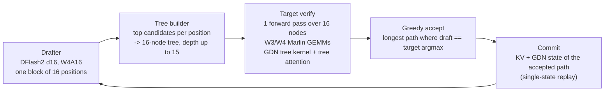
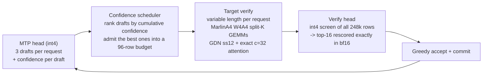

# atdev-serve

## Accuracy-validated development profiles for Qwen3.8-27B on one A100

**2026-11-01 update:** broader accuracy validation recovered MMLU-Pro and KMMLU to within
1 percentage point of the two-run stock INT4 mean, with **357.17 tok/s at c=1** and
**2,322.62 tok/s at c=32**. These are **1.82x / 1.32x** the stored best-vLLM throughput
references. [Full validation and limitations](docs/ACCURACY_RECOVERY.md).

> **Profile versus release:** these new measurements are validated development configurations.
> This documentation update does not replace the uploaded model weights or launcher defaults.
> The current `serve_c1.sh` / `serve_c32.sh` still launch the legacy W3 / unrotated W4A4 profiles;
> they do **not** reproduce the new accuracy table as-is. The recovered c32 profile additionally
> needs rotated weights and corresponding runtime changes not included in this documentation update.

- c=1 means one request at a time; c=32 means 32 concurrent requests.
- Drop-in plugin for unmodified `vllm==0.31.0`, with the usual OpenAI-compatible API.
- [Code installation guide](docs/USER_GUIDE.md) / [AI setup guide](AI_SETUP.md).
- [Hugging Face artifacts](https://huggingface.co/atdev-company/Qwen3.8-27B-atdev-c1): clean d16 drafter
  and **legacy W3 overlays**; recovered c1 disables those overlays.
- [Training, calibration and licenses](docs/DATA_AND_LICENSES.md): distinguishes drafter learning,
  token-order statistics, c32 quantization calibration and evaluation-only data.

## Results at a glance

One A100 80GB, vLLM 0.31.0, greedy decoding. Speed workload: 96 fixed prompts (39 Korean),
up to 1,024 output tokens; two measured repetitions per recovered profile.

| configuration | c=1 mean decode tok/s | c=32 aggregate output tok/s |
|---|---:|---:|
| Stored best stock vLLM INT4 reference | 196.5 | 1,757.1 |
| **Accuracy-recovered development profile** | **357.17 (1.82x)** | **2,322.62 (1.32x)** |
| Legacy public full stack — historical, different numerics | 408.9 | 2,730.9 |

The recovered profiles give up **12.65% / 14.95%** of the legacy public speed. Baseline
throughputs above are historical stored measurements, not remeasured in this session. The old
14.2x / 4.1x bf16 comparisons and ladder charts describe the legacy profile, not the recovered one.

| accuracy | stock INT4 run 1 / 2 | recovered c1 | recovered c32 |
|---|---:|---:|---:|
| MMLU-Pro (1,400) | 71.50% / 71.93% | 71.43% | 71.71% |
| KMMLU (1,125) | 67.11% / 66.58% | 66.22% | 67.20% |
| IFEval prompt strict (541) | 83.36% / 82.44% | 82.99% | 84.47% |
| HumanEval+ (164, executed tests) | 90.24% / 91.46% | 91.46% | 92.68% |
| MBPP+ (378, executed tests) | 76.72% / 76.19% | 76.98% | 76.72% |
| GSM8K all 1,319 | 94.62% (one stock run) | 94.77% | 94.54% |
| WikiText-2 perplexity | 7.29872 | 7.30004 | 7.20929 |
| Long-context retrieval | — | 36/36 | 36/36 |

C1 restores the INT4 target body by disabling all extra W3 paths. C32 uses Hadamard-rotated
weights and restores `down_proj` activation precision to W4A8. Low-bit verify heads remain
approximate. C32 MBPP **base** is 89.68%, 1.85 / 1.32 points below the two stock runs;
MBPP+ is near stock. Near-reference aggregate scores do not establish universal losslessness.
IFEval references and candidates use the same deterministic scoring adapter; see the
[full scoring conditions, paired comparisons and audit](docs/ACCURACY_RECOVERY.md).

> **Built by [ATDEV](https://www.atdev.co.kr).** We tune model inference on your GPUs:
> custom kernels, speculative decoding, quantization and serving-stack tuning.
> [atdev@atdev.co.kr](mailto:atdev@atdev.co.kr)

## Quick start

These commands run the **currently published legacy profiles**, not the recovered development
profiles measured above. Read the [profile/release distinction](docs/ACCURACY_RECOVERY.md) before
using the results as a deployment accuracy claim.

You need: Linux, an **A100 80GB**, an NVIDIA driver that supports CUDA 13.0, 80 GB of free disk,
and Hugging Face Hub access. The step-by-step guide is [docs/USER_GUIDE.md](docs/USER_GUIDE.md).

**Option A: Docker** (you do not need to install CUDA on the host)

```bash
git clone https://github.com/atdev-company/atdev-serve && cd atdev-serve
docker compose --profile c1 up --build        # single-user stack on port 8100
# or: docker compose --profile c32 up --build # 32-concurrent-request stack
```

**Option B: Python virtualenv** (needs the CUDA 13.0 toolkit with `nvcc` on the host)

```bash
git clone https://github.com/atdev-company/atdev-serve && cd atdev-serve
./install.sh                 # checks the machine, creates .venv, installs vllm==0.31.0 + atdev-serve
source atdev-env.sh          # activates .venv and sets CUDA_HOME for the kernel build
./serve_c1.sh                # or ./serve_c32.sh
```

The first start JIT-compiles the CUDA kernels and downloads the models, so it is slow. Later starts
reuse the cache. Then send requests:

```bash
curl http://127.0.0.1:8100/v1/chat/completions -H 'Content-Type: application/json' \
  -d '{"model":"m","messages":[{"role":"user","content":"Hello!"}],"temperature":0,"max_tokens":128}'
```

### Which stack should I run?

**Pick in 10 seconds:**

| If you... | Run |
|---|---|
| chat with the model yourself, or use it as a personal or coding assistant | `./serve_c1.sh` |
| run one agent that calls the model step by step and want each step fast | `./serve_c1.sh` |
| serve a chatbot or API to many users at the same time | `./serve_c32.sh` |
| run several agents in parallel, or process many documents in a batch | `./serve_c32.sh` |
| are not sure | start with `./serve_c1.sh`; switch to `./serve_c32.sh` once you regularly have more than ~4 requests in flight |

| | `serve_c1.sh` | `serve_c32.sh` |
|---|---|---|
| Best for | one user or a few users, lowest latency per request | many simultaneous users, highest total throughput |
| Typical use cases | local or personal assistant, coding copilot, a single agent running tool calls one after another, interactive chat where response time matters | chatbot or API service for many users, team-wide assistants, multi-agent systems, batch jobs (summarization, extraction, evaluation) |
| Speculative decoding | re-trained DFlash2 drafter (block 16) + 16-node token-tree verification | built-in MTP head, k=3, confidence-scheduled variable-length verification |
| Extra downloads | W3 overlay (12.5 GB) + drafter (1.35 GB) | none |
| Measured at | 1 request in flight | 32 requests in flight |

Both stacks serve any number of requests. They are just tuned for different loads.

## How it works

One decode step has three parts. A cheap **drafter** guesses several next tokens. The 27B
**target** model checks all the guesses in one forward pass (verification). Then the engine keeps
the longest correct prefix. Acceptance uses the configured target verification path. Low-bit target and verify-head
approximations can change final answers; there is no blanket bit-identity claim against stock INT4.
Qwen3.8-27B is a hybrid model: 48 Gated DeltaNet (GDN, linear-attention) layers and 16 full-attention
layers, so verification needs kernels for both.

The mechanism diagrams and per-feature gains below describe the **historical development
ladder**. They are not additive gains or a reproduction recipe for the November 1 profiles.

### c=1 (1 client, one request at a time): wide, deep token trees



| technique | type | what it does | measured effect |
|---|---|---|---|
| Tree verification (`dflash_tree`) | engine | Turns the DFlash2 candidate scores into a 16-node token tree and verifies all branches in one target pass instead of one chain | with GDN single-state + split-KV attention: 196.5 -> 242.0 tok/s (1.23x, same files) |
| GDN single-state verify (`gdn_single_state`) | engine | Verification writes the GDN recurrent state once instead of once per draft token. Accepted tokens are replayed from a small log | part of the 1.23x step above |
| CUDA GDN tree kernel (`gdn_tree_cuda`) | engine | One fused CUDA kernel runs the gated delta-rule recurrence over the tree's ancestor paths, conv, gating and norm | +3.0% |
| Candidate-selection approximations (`shadow_head`, `draft_vocab`) | engine | The drafter scores only a 64k frequent-token vocabulary with an int4 copy of `lm_head`. These are used **only to choose candidates**, and accepted tokens are checked by the configured target path; low-bit verify heads are approximate | +7.5% |
| Tuned Marlin tiles + fused epilogues (`marlin_plus`, `c1_fuse`) | engine | Per-shape launch configs for M=16 W4A16 GEMMs. RMSNorm, residual and SiLU-mul are folded into the GEMM epilogues | +2.4%, +3.5% |
| Exact tree attention (`tree_attn`) | engine | CUDA tree-masked split-KV attention that reproduces vLLM's Triton kernel bit for bit, with the gate and KV write fused | 16 layers at 1k context: 655 -> 370 us |
| Bit-identical glue cuts (`ll1_fuse`, `ll5_fuse`, graph stream forks) | engine | Small drafter / accept kernels fused or moved onto side streams inside CUDA graphs | about +1-2% in total |
| 3-bit weights (W3 overlay, `w3_mixed`) | model-side | GPTQ 3-bit (act-order) on 400 linear layers, served by fused W3 Marlin kernels | MLP only: +6.5%, all layers: +4.3% more |
| Re-trained drafter, block 16 (`drafter_w4`) | model-side | DFlash2 self-distilled on the target's outputs, block 16 for depth-15 trees, int4 weights | served tokens/step 4.52 -> 4.68, +3.8% |
| Split verify head (`verify_split_head`) | model-side | Verify `lm_head`: int8 rows for the 64k frequent tokens, int4 rows for the rest | +4.4%, then int8 rows +3.5% |

### c=32 (32 concurrent clients): keep a large batch busy



| technique | type | what it does | measured effect |
|---|---|---|---|
| Confidence-scheduled varlen verify (`di1_varlen`) | engine | MTP drafts k=3, but each step verifies only the drafts with the highest cumulative confidence, within the row budget of k=2 (96 rows at 32 requests). Uses vLLM's built-in adaptive-verification machinery, enabled for this hybrid model | tokens/step 2.24-2.31 -> 2.41-2.47, +2.1% to +2.9% |
| GDN single-state verify kernels (`gdn_ss12`) | engine | Variable-length GDN verify that writes one state per request and balances the work across CTAs | first version (ss4) on the W4A4 stack: +5.75%. Later versions add small bit-identical gains |
| Exact c=32 attention (`c32_attn`) | engine | CUDA verify attention, bit-identical to the stock path, faster | +1.7% |
| Draft vocabulary for MTP (`draft_vocab`) | engine | The MTP head scores a 64k frequent-token vocabulary in int4, for drafting only | +3% |
| W4A4 verify GEMMs (MarlinA4, `marlin_plus`, `fused_quant`) | model-side | 4-bit activations on the large verify GEMMs. The activation quantizers are fused into the preceding norm/SiLU kernels, and the GEMMs use split-K with a parallel reduction | about +7% at first, then many smaller tuning steps |
| Int4 verify-head screen + exact rescoring (`vsplit_a4scr`) | model-side | An int4 W4A4 pass over all 248k `lm_head` rows picks 16 candidates per row, and those are rescored exactly in bf16. The head goes from 1.34 to 0.63 ms at M=96 | +2.2% |
| Int4 MTP head + pruning (`mtp_w4`, `mtp_prune`) | model-side | Smaller drafter weights. Pass 1 runs only the rows that are needed | +1.8% |

More detail, the step-time breakdown and the full milestone history are in
[docs/HOW_IT_WORKS.md](docs/HOW_IT_WORKS.md).

## Accuracy

Use the [November 1 full accuracy report](docs/ACCURACY_RECOVERY.md) and
[machine-readable aggregate evidence](docs/accuracy_recovery.json). GSM8K and long-context alone
were insufficient to establish broad accuracy for the earlier public profiles. Do not associate
those profiles' historical gate results with the recovered development measurements.

All measurements use greedy decoding, temperature 0, thinking disabled. Sampling is unvalidated.
MMLU-Pro and KMMLU use selected subsets (1,400 / 1,125), not their entire upstream test sets.
C32 knowledge accuracy was generated twice; c1 broad evaluation once. Both speed measurements
were repeated twice. Several kernels are bit-identical individually, but the full low-bit stack
is not guaranteed to reproduce stock-model answers.

## Reproducing the numbers

This repository contains the legacy serving package. The recovered development configurations
and the remaining packaging gap are documented in the accuracy report. Historical launch recipes
below must not be treated as reproduction of the new measurements. The legacy metric definitions,
exact baseline `vllm serve` commands and how to compare on your own GPU are in
[docs/BENCHMARKS.md](docs/BENCHMARKS.md). Measure the baseline and atdev in the same session on the
same GPU.

## Requirements

* NVIDIA **A100 80GB** (sm_80), Linux, an NVIDIA driver for CUDA 13.0
* **Python 3.12** and **vLLM 0.31.0** from pip (unmodified; torch 2.13.0+cu130 comes with it). The
  plugin changes vLLM only at runtime and never patches files on disk.
* **CUDA 13.0 toolkit with `nvcc`** and `g++` for the first-start kernel builds (the Docker image
  includes both)
* A **writable install location**: generated kernel sources go into the installed package, and
  compiled kernels go to `TORCH_EXTENSIONS_DIR` (default `~/.cache/torch_extensions`)
* Disk, about 50 GB in total: target 19 GB, W3 overlay 12.5 GB, atdev drafter 1.35 GB, stock DFlash2
  repo up to 3.6 GB (c=1), Python env ~9 GB, kernel cache ~2 GB. Keep 80 GB free to be safe.

## Repository layout

```
serve_c1.sh, serve_c32.sh     launch scripts (features + per-stack options as env vars)
install.sh                    venv installer with preflight checks (--dry-run to preview)
docker/, docker-compose.yml   container image + compose profiles c1 / c32
AI_SETUP.md                   end-to-end setup instructions for AI coding agents
src/atdev_serve/              the vLLM plugin: register.py (entry point), feature modules,
  csrc/                       CUDA sources (JIT-built), incl. vLLM-derived Marlin kernels
  data/token_order.npy        draft-vocabulary frequency order
docs/                         USER_GUIDE, BENCHMARKS, HOW_IT_WORKS, charts
```

## Model files

Here c=1 means the stack tuned for 1 client (`serve_c1.sh`), and c=32 the stack for 32 concurrent clients.

| | used by | license |
|---|---|---|
| [`RedHatAI/Qwen3.8-27B-INT4`](https://huggingface.co/RedHatAI/Qwen3.8-27B-INT4) | both stacks (target) | Apache-2.0 |
| [`Qwen/Qwen3.8-27B`](https://huggingface.co/Qwen/Qwen3.8-27B) | bf16 baseline rung only | Apache-2.0 |
| [`z-lab/Qwen3.8-27B-DFlash2`](https://huggingface.co/z-lab/Qwen3.8-27B-DFlash2) | c=1 (config; weights replaced by the atdev drafter) | Apache-2.0 |
| [`atdev-company/Qwen3.8-27B-atdev-c1`](https://huggingface.co/atdev-company/Qwen3.8-27B-atdev-c1) | c=1: `w3/` (3-bit overlay, 12.5 GB) and `drafter/` (re-trained DFlash2 drafter, 1.35 GB) | Apache-2.0 |

The additionally trained drafter and legacy W3 calibration use UltraChat `train_sft` and GSM8K
`train`, with target-generated responses. Clean2 token-order statistics add 4,000 UltraChat records.
The recovered c32 quantization calibration additionally uses FineWeb-2 Korean and FineWeb-Edu
English (ODC-BY). These are calibration sources, not additional drafter training.
See [data splits, counts, roles and license notices](docs/DATA_AND_LICENSES.md).

## License

Apache-2.0 (see `LICENSE`). Third-party code is listed in `NOTICE`: vLLM and Marlin (Apache-2.0),
PyTorch (BSD-3-Clause, `licenses/LICENSE.pytorch`) and flash-linear-attention (MIT). Model files have
their own licenses, which are listed on their model cards. Dataset terms remain separate: MIT
for the two drafter prompt sources; ODC-BY for the new FineWeb calibration; KMMLU is CC BY-ND
and evaluation-only. We publish aggregate results here, not benchmark text. The license inventory
records the reviewed scope and unresolved upstream content rights; it is not blanket legal clearance.

## Work with ATDEV

[ATDEV](https://www.atdev.co.kr) optimizes LLM inference for **your model on your target GPUs**.
This repository is one example of that work. The latest accuracy-recovered development profiles
measure 357.17 / 2,322.62 tok/s on one A100, or 1.82x / 1.32x the stored best-vLLM INT4 references.
Deployment packaging and measured numerical profiles are distinguished above.

What we do:

* **Custom kernels.** Model-specific GEMM, attention and linear-attention kernels, fusions and
  CUDA-graph work.
* **Speculative decoding.** Drafter selection and training, tree verification, and verify scheduling
  for both latency and throughput.
* **Quantization.** Weight and activation low-bit formats chosen together with the kernels that serve
  them, and validated with accuracy gates.
* **Serving-stack tuning.** vLLM / SGLang configuration, batching and memory planning for your traffic.

Beyond inference optimization, ATDEV delivers end-to-end AI solutions for enterprises:

* **Forward-deployed engineering.** An experienced team of forward-deployed engineers (FDEs) works
  directly with your teams, from discovery and prototyping to production rollout and operations.
* **AI agent development, end to end.** Requirements analysis, architecture, tool and workflow
  integration, evaluation, deployment and monitoring of production agents.
* **In-house solutions.** Proven platforms for retrieval-augmented generation (RAG), document parsing
  and OCR, ready to adapt to your data and infrastructure.
* **Model fine-tuning.** Domain adaptation of LLMs, vision-language models (VLMs), OCR models and
  other deep learning models, including data preparation, training and evaluation.

How much we gain depends on the model, the hardware and the workload, so we measure before we promise
anything. For business inquiries, contact **[atdev@atdev.co.kr](mailto:atdev@atdev.co.kr)**.
