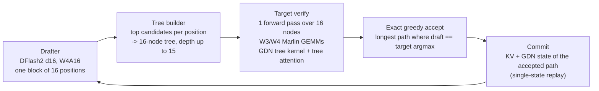
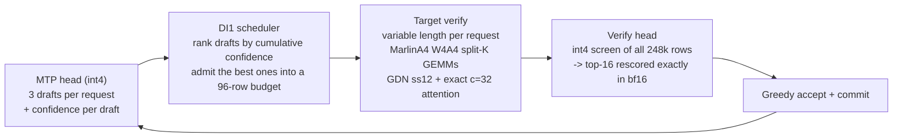

# atdev-serve

## Up to 14.2× faster Qwen3.8-27B inference on a single A100, passing our accuracy gates

- **14.2×** faster single-user decoding than the original bf16 model on stock vLLM (28.9 → **408.9 tok/s**)
- **2.08×** faster than the best stock-vLLM configuration we could find (196.5 → 408.9 tok/s)
- **4.1×** more throughput at 32 concurrent requests than bf16 on stock vLLM, and **1.55×** more than the best vLLM settings (→ **2,730.9 tok/s**)
- Drop-in plugin for unmodified `vllm==0.31.0`: same OpenAI-compatible server and API

**Faster Qwen3.8-27B decoding on one NVIDIA A100 80GB, as a plugin for stock vLLM 0.31.0.**

atdev-serve installs next to an unmodified `pip install vllm==0.31.0` and hooks in through vLLM's
plugin entry point. It adds custom CUDA kernels, tree-based speculative decoding, fusions and
scheduling. You pick a configuration with one launch script and talk to the usual OpenAI-compatible
vLLM server.

> **Using an AI coding agent?** Give it the path or URL of [`AI_SETUP.md`](AI_SETUP.md)
> (`https://github.com/atdev-company/atdev-serve/blob/main/AI_SETUP.md`). That file contains
> everything the agent needs to install, launch and verify the server on its own.

> **Built by [ATDEV](https://www.atdev.co.kr).** We tune LLM inference for your model on your GPUs:
> custom kernels, speculative decoding, quantization and serving-stack tuning. See
> [Work with ATDEV](#work-with-atdev) or write to [atdev@atdev.co.kr](mailto:atdev@atdev.co.kr).

## Results at a glance

Qwen3.8-27B on 1x A100 80GB, vLLM 0.31.0, greedy decoding, 96 fixed prompts (coding, agentic,
general, math; 39 in Korean), up to 1024 output tokens each.

| | **single user (c=1)**<br>decode tok/s per request | **32 concurrent requests (c=32)**<br>aggregate output tok/s |
|---|---:|---:|
| Original bf16 model, vLLM defaults | 28.9 | 671.8 |
| INT4 checkpoint (RedHatAI), vLLM defaults | 74.9 | 1,264.7 |
| INT4 + **best vLLM settings** we found | 196.5 | 1,757.1 |
| **atdev-serve, engine only** (same model files as vLLM) | 284.4 (**1.45x** vs best vLLM) | 2,135.7 (**1.22x**) |
| **atdev-serve, full stack** (engine + model-side changes) | **408.9** (**2.08x**) | **2,730.9** (**1.55x**) |
| full stack vs original bf16 + vLLM defaults | **14.2x** | **4.1x** |

<picture>
  <source media="(prefers-color-scheme: dark)" srcset="docs/img/ladder_c1-dark.svg">
  
</picture>
<picture>
  <source media="(prefers-color-scheme: dark)" srcset="docs/img/ladder_c32-dark.svg">
  
</picture>

Two kinds of results are reported separately:

* **Engine only.** atdev-serve uses the **same model files** as the vLLM baseline (RedHatAI INT4
  target, stock `z-lab/Qwen3.8-27B-DFlash2` drafter or the built-in MTP head) and the same vLLM
  flags. Only engine work is added: kernels, fusions, the tree-verification algorithm, scheduling and
  metadata.
* **Full stack.** The engine plus **model-side changes** that a vLLM user could also make on their
  own: 3-bit weights, a re-trained drafter, W4A4 activations, low-bit verify-head parts. These change
  model files or numerics. Accuracy gates cover them (see [Accuracy](#accuracy)).

All accuracy gates pass: GSM8K stays within 1 point of the stock vLLM reference and long-context
retrieval is 36/36 in every configuration. Details and the full method are in
[docs/BENCHMARKS.md](docs/BENCHMARKS.md).

## Quick start

You need: Linux, an **A100 80GB**, an NVIDIA driver that supports CUDA 13.0, 80 GB of free disk,
and Hugging Face Hub access. The step-by-step guide is [docs/USER_GUIDE.md](docs/USER_GUIDE.md).

**Option A: Docker** (you do not need to install CUDA on the host)

```bash
git clone https://github.com/atdev-company/atdev-serve && cd atdev-serve
docker compose --profile c1 up --build        # single-user stack on port 8100
# or: docker compose --profile c32 up --build # 32-concurrent-request stack
```

**Option B: Python virtualenv** (needs the CUDA 13.0 toolkit with `nvcc` on the host)

```bash
git clone https://github.com/atdev-company/atdev-serve && cd atdev-serve
./install.sh                 # checks the machine, creates .venv, installs vllm==0.31.0 + atdev-serve
source .venv/bin/activate
./serve_c1.sh                # or ./serve_c32.sh
```

The first start JIT-compiles the CUDA kernels and downloads the models, so it is slow. Later starts
reuse the cache. Then send requests:

```bash
curl http://127.0.0.1:8100/v1/chat/completions -H 'Content-Type: application/json' \
  -d '{"model":"m","messages":[{"role":"user","content":"Hello!"}],"temperature":0,"max_tokens":128}'
```

### Which stack should I run?

| | `serve_c1.sh` | `serve_c32.sh` |
|---|---|---|
| Best for | one user or a few users, lowest latency per request | many simultaneous users, highest total throughput |
| Speculative decoding | re-trained DFlash2 drafter (block 16) + 16-node token-tree verification | built-in MTP head, k=3, confidence-scheduled variable-length verification |
| Extra downloads | W3 overlay (12.5 GB) + drafter (1.35 GB) | none |
| Measured at | 1 request in flight | 32 requests in flight |

Both stacks serve any number of requests. They are just tuned for different loads.

## How it works

One decode step has three parts. A cheap **drafter** guesses several next tokens. The 27B
**target** model checks all the guesses in one forward pass (verification). Then the engine keeps
the longest correct prefix. With greedy decoding the output is what the target alone would produce,
and the speed comes from accepting many tokens per step while making each step cheap.
Qwen3.8-27B is a hybrid model: 48 Gated DeltaNet (GDN, linear-attention) layers and 16 full-attention
layers, so verification needs kernels for both.

### c=1: wide, deep token trees



| technique | type | what it does | measured effect |
|---|---|---|---|
| Tree verification (`dflash_tree`) | engine | Turns the DFlash2 candidate scores into a 16-node token tree and verifies all branches in one target pass instead of one chain | with GDN single-state + split-KV attention: 196.5 -> 242.0 tok/s (1.23x, same files) |
| GDN single-state verify (`gdn_single_state`) | engine | Verification writes the GDN recurrent state once instead of once per draft token. Accepted tokens are replayed from a small log | part of the 1.23x step above |
| CUDA GDN tree kernel (`gdn_tree_cuda`) | engine | One fused CUDA kernel runs the gated delta-rule recurrence over the tree's ancestor paths, conv, gating and norm | +3.0% |
| Candidate-selection approximations (`shadow_head`, `draft_vocab`) | engine | The drafter scores only a 64k frequent-token vocabulary with an int4 copy of `lm_head`. These are used **only to choose candidates**, and every accepted token is verified by the exact path | +7.5% |
| Tuned Marlin tiles + fused epilogues (`marlin_plus`, `c1_fuse`) | engine | Per-shape launch configs for M=16 W4A16 GEMMs. RMSNorm, residual and SiLU-mul are folded into the GEMM epilogues | +2.4%, +3.5% |
| Exact tree attention (`tree_attn`) | engine | CUDA tree-masked split-KV attention that reproduces vLLM's Triton kernel bit for bit, with the gate and KV write fused | 16 layers at 1k context: 655 -> 370 us |
| Bit-identical glue cuts (`ll1_fuse`, `ll5_fuse`, graph stream forks) | engine | Small drafter / accept kernels fused or moved onto side streams inside CUDA graphs | about +1-2% in total |
| 3-bit weights (W3 overlay, `w3_mixed`) | model-side | GPTQ 3-bit (act-order) on 400 linear layers, served by fused W3 Marlin kernels | MLP only: +6.5%, all layers: +4.3% more |
| Re-trained drafter, block 16 (`drafter_w4`) | model-side | DFlash2 self-distilled on the target's outputs, block 16 for depth-15 trees, int4 weights | served tokens/step 4.52 -> 4.68, +3.8% |
| Split verify head (`verify_split_head`) | model-side | Verify `lm_head`: int8 rows for the 64k frequent tokens, int4 rows for the rest | +4.4%, then int8 rows +3.5% |

### c=32: keep a large batch busy



| technique | type | what it does | measured effect |
|---|---|---|---|
| DI1 confidence-scheduled varlen verify (`di1_varlen`) | engine | MTP drafts k=3, but each step verifies only the drafts with the highest cumulative confidence, within the row budget of k=2 (96 rows at 32 requests). Uses vLLM's built-in adaptive-verification machinery, enabled for this hybrid model | tokens/step 2.24-2.31 -> 2.41-2.47, +2.1% to +2.9% |
| GDN single-state verify kernels (`gdn_ss12`) | engine | Variable-length GDN verify that writes one state per request and balances the work across CTAs | first version (ss4) on the W4A4 stack: +5.75%. Later versions add small bit-identical gains |
| Exact c=32 attention (`c32_attn`) | engine | CUDA verify attention, bit-identical to the stock path, faster | +1.7% |
| Draft vocabulary for MTP (`draft_vocab`) | engine | The MTP head scores a 64k frequent-token vocabulary in int4, for drafting only | +3% |
| W4A4 verify GEMMs (MarlinA4, `marlin_plus`, `fused_quant`) | model-side | 4-bit activations on the large verify GEMMs. The activation quantizers are fused into the preceding norm/SiLU kernels, and the GEMMs use split-K with a parallel reduction | about +7% at first, then many smaller tuning steps |
| Int4 verify-head screen + exact rescoring (`vsplit_a4scr`) | model-side | An int4 W4A4 pass over all 248k `lm_head` rows picks 16 candidates per row, and those are rescored exactly in bf16. The head goes from 1.34 to 0.63 ms at M=96 | +2.2% |
| Int4 MTP head + pruning (`mtp_w4`, `mtp_prune`) | model-side | Smaller drafter weights. Pass 1 runs only the rows that are needed | +1.8% |

More detail, the step-time breakdown and the full milestone history are in
[docs/HOW_IT_WORKS.md](docs/HOW_IT_WORKS.md).

## Accuracy

Greedy decoding, thinking disabled. GSM8K takes the answer from `\boxed{}` (`bench/acc_gsm8k.py`).
Long-context is 36 passkey / multi-key retrieval items at 2k-6.5k tokens (`bench/acc_longctx.py`).

| configuration | GSM8K (first 300) | GSM8K (all 1319) | long-context |
|---|---:|---:|---:|
| Original bf16, vLLM defaults | | 0.9469 | 36/36 |
| INT4, vLLM defaults | | 0.9431 | 36/36 |
| best vLLM, c=1 settings | 0.973 | 0.9462 | 36/36 |
| best vLLM, c=32 settings | 0.953 | 0.9439 | 36/36 |
| atdev engine only, c=1 | 0.963 | | 36/36 |
| atdev engine only, c=32 | | 0.9447 | 36/36 |
| **atdev full stack, c=1** | **0.967** | **0.9500** | **36/36** |
| **atdev full stack, c=32** | | **0.9401** | **36/36** |

Pass rule: GSM8K within 1 point of the matching stock vLLM reference, and long-context 36/36. A
blank cell means that gate was not run for that configuration.

**About greedy decoding.** All numbers use temperature 0, and the speculative paths are validated
for greedy verification. Several engine features are bit-identical to stock vLLM. The full stack is
not bit-identical, because it changes numerics (3-bit weights, W4A4, low-bit verify-head parts). The
gates above cover those changes. Sampling (temperature > 0) is not validated in this release.

**About the hardware.** All kernels are compiled for sm_80 and tuned for the A100 80GB (SXM). Other
GPUs are not supported by this release.

## Reproducing the numbers

```bash
pip install aiohttp                                          # or: pip install ".[bench]"
bench/run_bench.sh vllm_c1  results/vllm_c1                  # best stock vLLM, c=1
bench/run_bench.sh c1       results/atdev_c1                 # atdev full stack, c=1
bench/run_bench.sh vllm_c32 results/vllm_c32
bench/run_bench.sh c32      results/atdev_c32
MODEL=Qwen/Qwen3.8-27B bench/run_bench.sh default_c1 results/bf16_default_c1   # bottom rung
ACC=1 ACC_N=1319 LONGCTX=1 bench/run_bench.sh c1 results/atdev_c1_gate           # accuracy gates
python bench/paired_c1.py results/vllm_c1 results/atdev_c1   # paired per-prompt ratio
```

Measure the baseline and atdev in the same session on the same GPU. See
[docs/BENCHMARKS.md](docs/BENCHMARKS.md) for the metric definitions and the baseline sweeps.

## Requirements

* NVIDIA **A100 80GB** (sm_80), Linux, an NVIDIA driver for CUDA 13.0
* **Python 3.12** and **vLLM 0.31.0** from pip (unmodified; torch 2.13.0+cu130 comes with it). The
  plugin changes vLLM only at runtime and never patches files on disk.
* **CUDA 13.0 toolkit with `nvcc`** and `g++` for the first-start kernel builds (the Docker image
  includes both)
* A **writable install location**: generated kernel sources go into the installed package, and
  compiled kernels go to `TORCH_EXTENSIONS_DIR` (default `~/.cache/torch_extensions`)
* Disk, about 50 GB in total: target 19 GB, W3 overlay 12.5 GB, atdev drafter 1.35 GB, stock DFlash2
  repo up to 3.6 GB (c=1), Python env ~9 GB, kernel cache ~2 GB. Keep 80 GB free to be safe.

## Repository layout

```
serve_c1.sh, serve_c32.sh     launch scripts (every setting spelled out as an env var)
install.sh                    venv installer with preflight checks (--dry-run to preview)
docker/, docker-compose.yml   container image + compose profiles c1 / c32
AI_SETUP.md                   end-to-end setup instructions for AI coding agents
src/atdev_serve/              the vLLM plugin: register.py (entry point), feature modules,
  csrc/                       CUDA sources (JIT-built), incl. vLLM-derived Marlin kernels
  data/token_order.npy        draft-vocabulary frequency order
bench/                        benchmark client, accuracy gates, prompts, baseline launch scripts
docs/                         USER_GUIDE, BENCHMARKS, HOW_IT_WORKS, results.json, charts
tools/                        make_charts.py (charts from docs/results.json), build_draft_vocab.py
```

## Model files

| | used by | license |
|---|---|---|
| [`RedHatAI/Qwen3.8-27B-INT4`](https://huggingface.co/RedHatAI/Qwen3.8-27B-INT4) | both stacks (target) | see model card |
| [`z-lab/Qwen3.8-27B-DFlash2`](https://huggingface.co/z-lab/Qwen3.8-27B-DFlash2) | c=1 (config; weights replaced by the atdev drafter) | Apache-2.0 |
| [`atdev-company/Qwen3.8-27B-atdev-W3-overlay`](https://huggingface.co/atdev-company/Qwen3.8-27B-atdev-W3-overlay) | c=1 | Apache-2.0 |
| [`atdev-company/Qwen3.8-27B-atdev-DFlash2-d16`](https://huggingface.co/atdev-company/Qwen3.8-27B-atdev-DFlash2-d16) | c=1 | Apache-2.0 |

The atdev drafter and the W3 calibration used only prompts from
`HuggingFaceH4/ultrachat_200k` (train_sft) and `openai/gsm8k` (train), with responses generated by
the target model.

## License

Apache-2.0 (see `LICENSE`). Third-party code is listed in `NOTICE`: vLLM and Marlin (Apache-2.0),
PyTorch (BSD-3-Clause, `licenses/LICENSE.pytorch`) and flash-linear-attention (MIT). Model files have
their own licenses, which are listed on their model cards.

## Work with ATDEV

[ATDEV](https://www.atdev.co.kr) optimizes LLM inference for **your model on your target GPUs**.
This repository is one example of that work: on one A100, Qwen3.8-27B decodes **2.08x**
faster for a single user and serves **1.55x** more tokens per second at 32 concurrent
requests than the best stock vLLM configuration we could find, with accuracy gates in place.

What we do:

* **Custom kernels.** Model-specific GEMM, attention and linear-attention kernels, fusions and
  CUDA-graph work.
* **Speculative decoding.** Drafter selection and training, tree verification, and verify scheduling
  for both latency and throughput.
* **Quantization.** Weight and activation low-bit formats chosen together with the kernels that serve
  them, and validated with accuracy gates.
* **Serving-stack tuning.** vLLM / SGLang configuration, batching and memory planning for your traffic.

How much we gain depends on the model, the hardware and the workload, so we measure before we promise
anything. For business inquiries, contact **[atdev@atdev.co.kr](mailto:atdev@atdev.co.kr)**.
