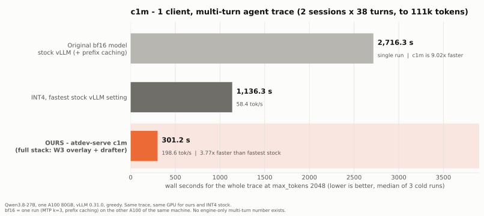
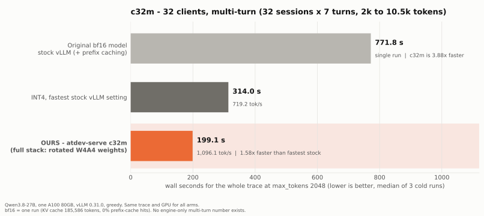
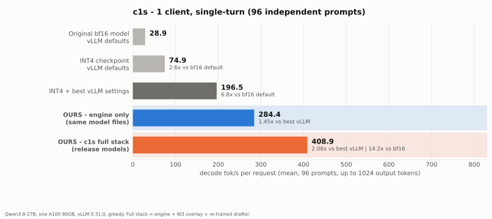
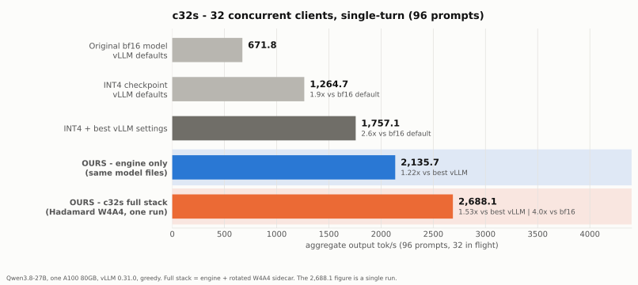
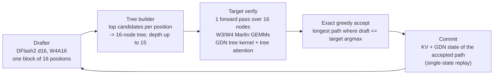
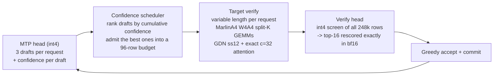
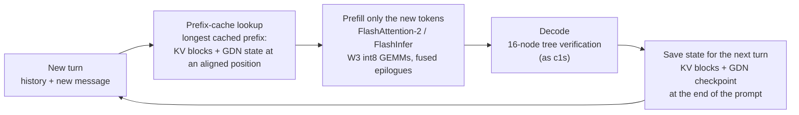
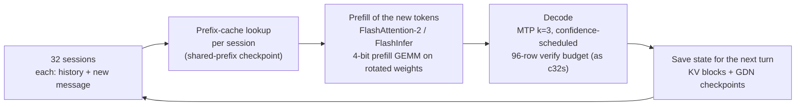

# atdev-serve: Qwen3.8-27B up to 14.2x single-turn, up to 9.0x multi-turn

## Qwen3.8-27B on one A100 80GB: faster agents, faster chat, lower energy per token

> **Easy setup on vLLM.** atdev-serve installs alongside unmodified **vLLM 0.31.0** and serves the familiar OpenAI-compatible API; install it by hand in four lines or hand it to your AI coding agent: see **[Install](#install)**. Requires a supported NVIDIA GPU (the published profiles target an A100 80GB).

**Four profiles, each tuned for its use case.** One user or 32, multi-turn or single-turn: run the build made for your workload with `./serve.sh c1m | c1s | c32m | c32s` ([which one?](#the-four-profiles)).

**Multi-turn and agent workloads (new)**

- **9.0x faster than the original bf16 model on stock vLLM at c1m:** the same agent trace (2 sessions x 38 turns, context growing to 111k tokens) takes **301.2 s** against 2,716.3 s (`max_tokens` 2048; 7.3x at 512, 5.1x at 128). Condition: bf16 is a single run of stock vLLM 0.31.0 (MTP k=3, prefix caching on) on the other A100 of the same machine; c1m is the median of 3 cold runs; full stack (W3 overlay + re-trained drafter).
- **5.45x faster than the original bf16 model on stock vLLM at c32m:** 32 sessions x 7 turns (2k to 10.5k tokens) finish in **73.4 s** against 399.8 s at `max_tokens` 128 (4.8x at 512, 3.9x at 2048). Condition: bf16 is a single run whose smaller KV cache (185,586 tokens) gave a 0% prefix-cache hit rate, which is part of why the gap is large; c32m is the median of 3 cold runs; full stack (rotated W4A4 weights).
- **3.77x faster agent conversations at c1m:** a scripted agent session (2 sessions x 38 turns, context growing to 111k tokens) finishes in **301.2 s** instead of 1,136.3 s on the fastest stock vLLM 0.31.0 setting we found. Condition: `max_tokens` 2048 per turn, cold start, median of 3 runs, same A100, full stack (W3 overlay + re-trained drafter). 2.32x at `max_tokens` 128 and 3.04x at 512.
- **1.58x faster for 32 concurrent multi-turn sessions at c32m:** 199.1 s instead of 314.0 s (32 sessions x 7 turns, 2k to 10.5k tokens, `max_tokens` 2048, median of 3 cold runs, same GPU), 1,096 aggregate output tok/s. Full stack: rotated W4A4 weights.
- **Long context on one GPU:** c1m serves a 131,072-token window (the trace above reaches 111k tokens) with prefix caching, so each turn prefills only what is new (cache hit rate 0.95).
- **Less energy per token:** at `max_tokens` 2048 the c1m run used 133 kJ against 405 kJ for stock vLLM (2.22 vs 6.10 J per output token, 0.33x); c32m used 76.5 kJ against 121.4 kJ (0.35 vs 0.54 J/token, 0.63x). NVML, same GPU.
- **Output-identical consolidation:** the release tree reproduces the frozen research run of c1m token for token (all 76 turns identical at `max_tokens` 128 and 512) at the same speed (115.0 / 204.4 s against 116.0 / 205.2 s).

**Single-turn, unchanged and still first-class**

- **14.2x** faster single-user decoding with **c1s** than the original bf16 model on stock vLLM (28.9 to **408.9 tok/s**, 96 prompts, up to 1,024 output tokens), **2.08x** the best stock-vLLM configuration we found (196.5 tok/s).
- **4.0x** the throughput of bf16 on stock vLLM at 32 concurrent requests with **c32s**, **1.53x** the best vLLM settings (**2,688.1 aggregate tok/s**, single measured run).
- Drop-in plugin for unmodified `vllm==0.31.0`: same OpenAI-compatible server and API.
- Model files on Hugging Face: [atdev-company/Qwen3.8-27B-atdev-c1](https://huggingface.co/atdev-company/Qwen3.8-27B-atdev-c1) (c1m / c1s: W3 overlay + DFlash2 drafter); [atdev-company/Qwen3.8-27B-atdev-c32](https://huggingface.co/atdev-company/Qwen3.8-27B-atdev-c32) (c32m / c32s: Hadamard weights), downloaded automatically as needed.

Every speedup above is a **full-stack** number (engine plus model-side changes: 3-bit weights, a re-trained drafter, W4A4 activations on rotated weights). The only **engine-only** numbers
(same model files as vLLM) are the single-turn ones: **1.45x** at c=1 and **1.22x** at c=32; no engine-only multi-turn number has been measured. See [Results](#results-at-a-glance) for conditions.

> **More models coming.** We are optimizing other widely used open models in the same way and will release them here and on [Hugging Face](https://huggingface.co/atdev-company) as they are ready. Watch or star this repository to get notified.

atdev-serve installs next to an unmodified `pip install vllm==0.31.0` and hooks in through vLLM's
plugin entry point. It adds custom CUDA kernels, tree-based speculative decoding, fusions,
prefix caching for hybrid models and scheduling. You pick a configuration with one launch script and talk to the usual OpenAI-compatible
vLLM server.

> **Built by [ATDEV](https://www.atdev.co.kr).** We tune LLM inference for your model on your GPUs:
> custom kernels, speculative decoding, quantization and serving-stack tuning. See
> [Work with ATDEV](#work-with-atdev) or write to [atdev@atdev.co.kr](mailto:atdev@atdev.co.kr).

## The four profiles

Use the profile tuned for your workload. Name = `c` + number of concurrent clients + `m` (multi-turn) or `s` (single-turn).

| Profile | Best for | vs bf16 on stock vLLM | Run |
|---|---|---|---|
| **c1m** | One user: coding agent, long chat, document Q&A | **9.0x** | `./serve.sh c1m` |
| **c1s** | One user: one-shot calls, short unrelated prompts | **14.2x** | `./serve.sh c1s` |
| **c32m** | 32 users: team assistant, agent fleet | **5.45x** | `./serve.sh c32m` |
| **c32s** | 32 users: batch jobs, API of independent requests | **4.0x** | `./serve.sh c32s` |

Largest measured multiples: c1m at `max_tokens` 2048, c32m at `max_tokens` 128. Not sure and one user? Use `c1m`. Full details: [profile comparison](#profile-comparison).

## Install

**Manual, in four lines** (Linux, one A100 80GB, NVIDIA driver for CUDA 13.0, CUDA 13.0 toolkit with `nvcc`, and Hugging Face access; Docker works too, see [Quick start](#quick-start)):

```bash
git clone https://github.com/atdev-company/atdev-serve && cd atdev-serve
./install.sh && source atdev-env.sh      # checks the machine, creates .venv, installs vllm==0.31.0 + atdev-serve
./serve.sh c1m                           # or c1s, c32m, c32s
```

The first start compiles kernels and downloads the models (12-16 minutes on our test machine). Everything else (preflight checks, Docker, environment variables, troubleshooting) is in [AI_SETUP.md](https://github.com/atdev-company/atdev-serve/blob/main/AI_SETUP.md) and [docs/USER_GUIDE.md](docs/USER_GUIDE.md).

**Or let an AI coding agent do it.** Paste one of these into your agent (Claude Code, Codex, Cursor, ...), on the GPU machine:

*c1m: one person with a coding agent or a long chat*

```text
Install atdev-serve on this machine and launch the c1m profile (one user, multi-turn). Follow https://github.com/atdev-company/atdev-serve/blob/main/AI_SETUP.md and use STACK=c1m.
Verify that the server answers a chat request, then tell me the endpoint URL and any problems you ran into.
```

*c1s: one-shot calls with short, unrelated prompts*

```text
Install atdev-serve on this machine and launch the c1s profile (one user, single-turn). Follow https://github.com/atdev-company/atdev-serve/blob/main/AI_SETUP.md and use STACK=c1s.
Verify that the server answers a chat request, then tell me the endpoint URL and any problems you ran into.
```

*c32m: a team or an agent fleet with growing conversations*

```text
Install atdev-serve on this machine and launch the c32m profile (32 clients, multi-turn). Follow https://github.com/atdev-company/atdev-serve/blob/main/AI_SETUP.md and use STACK=c32m.
Verify that the server answers a chat request, then tell me the endpoint URL and any problems you ran into.
```

*c32s: batch jobs or API traffic of independent requests*

```text
Install atdev-serve on this machine and launch the c32s profile (32 clients, single-turn). Follow https://github.com/atdev-company/atdev-serve/blob/main/AI_SETUP.md and use STACK=c32s.
Verify that the server answers a chat request, then tell me the endpoint URL and any problems you ran into.
```


## Results at a glance

Qwen3.8-27B on 1x A100 80GB, vLLM 0.31.0, greedy decoding, thinking off. Multi-turn charts show the wall time of a scripted conversation (lower is better, `max_tokens` 2048,
the longest output cap, where the gain is largest); single-turn charts show the 96-prompt benchmark (coding, agentic, general, math; 39 in Korean; up to 1,024 output tokens).

### c1m: 1 client, multi-turn

<picture>
  <source media="(prefers-color-scheme: dark)" srcset="docs/img/speed_c1m-dark.svg">
  
</picture>

### c32m: 32 clients, multi-turn

<picture>
  <source media="(prefers-color-scheme: dark)" srcset="docs/img/speed_c32m-dark.svg">
  
</picture>

The c32m headline is the final c32m bundle's 3-repetition run on trace v5-c32 (median 199.1 s; its three repetitions were 193.1, 199.1 and 199.5 s, mean 197.2 s, which is 1.59x). We quote the median everywhere in this repository so every table uses one rule.
The fastest stock setting at `max_tokens` 2048 is INT4 with int8 activations, MTP k=3 and `TRITON_ATTN` (median 314.0 s).

### c1s: 1 client, single-turn

<picture>
  <source media="(prefers-color-scheme: dark)" srcset="docs/img/speed_c1s-dark.svg">
  
</picture>

### c32s: 32 clients, single-turn

<picture>
  <source media="(prefers-color-scheme: dark)" srcset="docs/img/speed_c32s-dark.svg">
  
</picture>

| | **c=1: 1 client**<br/>decode tok/s per request | **c=32: 32 concurrent clients**<br/>aggregate output tok/s |
|---|---:|---:|
| Original bf16 model, vLLM defaults | 28.9 | 671.8 |
| INT4 checkpoint (RedHatAI), vLLM defaults | 74.9 | 1,264.7 |
| INT4 + **best vLLM settings** we found | 196.5 | 1,757.1 |
| **atdev-serve, engine only** (same model files as vLLM) | 284.4 (**1.45x** vs best vLLM) | 2,135.7 (**1.22x**) |
| **atdev-serve, full stack** (c1s / c32s) | **408.9** (**2.08x**) | **2,688.1** (**1.53x**) |
| atdev-serve c1s accuracy (W3 disabled) | 357.17 (**1.82x**) | n/a |
| full stack vs original bf16 + vLLM defaults | **14.2x** | **4.0x** |

Two kinds of results are reported separately:

* **Engine only.** atdev-serve uses the **same model files** as the vLLM baseline (RedHatAI INT4 target, stock `z-lab/Qwen3.8-27B-DFlash2` drafter or the built-in MTP head) and the same vLLM
  flags. Only engine work is added: kernels, fusions, the tree-verification algorithm, scheduling and metadata. Measured for single-turn only.
* **Full stack.** The engine plus **model-side changes**: 3-bit weights, a re-trained drafter, W4A4 activations on Hadamard-rotated weights, low-bit verify-head parts. These change
  model files or numerics. Accuracy gates cover them (see [Accuracy and validation](#accuracy-and-validation)). **All multi-turn numbers are full stack.**

### Speed by output length (`max_tokens`)

Wall-clock seconds for the whole scripted conversation, cold start, median of 3 runs, same GPU for both arms. "Stock" is the fastest stock vLLM 0.31.0 setting we found for that cell, with prefix caching on
(c1: INT4, default attention backend, no speculative decoding; c32: INT4, int8 activations, MTP k=3, the faster of `TRITON_ATTN` and the default backend). tok/s = generated tokens / wall time, prefill included.

**c1m, trace v5** (2 sessions x 38 turns, context 5k to 111k tokens, GPU1 of our test machine)

| `max_tokens` | stock vLLM | c1m | speedup | c1m tok/s | stock tok/s | original bf16 + vLLM (c1m is faster by) |
|---|---:|---:|---:|---:|---:|---:|
| 128 | 268.6 s | **116.0 s** | **2.32x** | 82.2 | 34.7 | 593.4 s (**5.12x**) |
| 512 | 623.1 s | **205.2 s** | **3.04x** | 159.4 | 52.0 | 1,497.5 s (**7.30x**) |
| 2048 | 1,136.3 s | **301.2 s** | **3.77x** | 198.6 | 58.4 | 2,716.3 s (**9.02x**) |

The bf16 column is the original Qwen3.8-27B bf16 model on stock vLLM 0.31.0 (MTP k=3, prefix caching on): **a single run**, on the other A100 of the same machine as the c1m runs (all other arms ran on one GPU). Its KV cache holds 248,680 tokens at 131,072 context; its prefix-cache hit rate was 0.95, the same as the other arms. The multiples against bf16 are the largest multi-turn numbers here (9.02x at `max_tokens` 2048); against the fastest stock setting the multiples are 2.32x / 3.04x / 3.77x.

**c32m, trace v5-c32** (32 sessions x 7 turns, 2k to 10.5k tokens)

| `max_tokens` | stock vLLM | c32m | speedup | c32m tok/s | stock tok/s | original bf16 + vLLM (c32m is faster by) |
|---|---:|---:|---:|---:|---:|---:|
| 128 | 115.1 s | **73.4 s** | **1.57x** | 386.3 | 245.5 | 399.8 s (**5.45x**) |
| 512 | 184.3 s | **117.6 s** | **1.57x** | 857.3 | 543.5 | 569.7 s (**4.84x**) |
| 2048 | 314.0 s | **199.1 s** | **1.58x** | 1,096.1 | 719.2 | 771.8 s (**3.88x**) |

The bf16 column is the original Qwen3.8-27B bf16 model on stock vLLM 0.31.0 (MTP k=3, prefix caching on): **a single run** on the same GPU as the other arms. Its weights leave a KV cache of only 185,586 tokens, smaller than the working set of 32 sessions, so its prefix cache thrashed: **0% hit rate and 6 / 88 / 126 preemptions** at caps 128 / 512 / 2048. That is part of why the gap to bf16 is large (largest at `max_tokens` 128: 5.45x); against the fastest stock INT4 setting the multiples are 1.57x / 1.57x / 1.58x.

**c32m, older trace v4** (32 sessions x 6 turns, prompts up to about 9k tokens; stock = fastest of FLASH_ATTN / TRITON_ATTN with MTP k=3). The first row set was measured on an earlier, unrotated C32 bundle
(3 reps, GPU1); the rotated c32m bundle was measured at caps 128 / 512 only (2 reps, GPU0, so the ratios against the GPU1 stock numbers are indicative).

| `max_tokens` | stock vLLM | earlier unrotated bundle | speedup | rotated c32m (GPU0) |
|---|---:|---:|---:|---:|
| 128 | 82.5 s | 54.3 s | 1.52x | 54.4 s (~1.52x) |
| 512 | 118.1 s | 78.7 s | 1.50x | 78.8 s (~1.50x) |
| 2048 | 189.2 s | 130.5 s | 1.45x | not measured |

**Why the c1m gap grows with output length, and why c32m does not.** At c=1 the gap grows from 2.32x to 3.04x to 3.77x because the two phases of a trace speed up by different amounts and the decode share grows with `max_tokens`.
Splitting the wall time into the summed time-to-first-token (prefill) and the rest (generation): prefill is 84.3 s / 84.5 s / 84.7 s for c1m against 130.4 s / 130.2 s / 131.0 s for stock, a flat **1.55x**, while
the generation phase is 31.7 / 120.7 / 216.5 s against 138.2 / 492.9 / 1,005.3 s, **4.1x-4.6x**. Prefill is 73% of the c1m run at `max_tokens` 128 and 28% at 2048, so the blend moves from 2.3x toward 4x as outputs get longer.
This works because stock vLLM here decodes without speculation, while c1m verifies a 16-node token tree per step.
At c=32 the ratio is flat at about 1.57x-1.58x for all three caps. With 32 sessions in flight, prefill chunks and decode steps share the same GPU steps, so there is no clean prefill/decode split like the one above, and
**we have not measured why the ratio stays flat**; the stock baseline at c=32 already decodes with MTP speculation and large batches, which narrows the decode-side gap that drives the c1m growth, but that is a hypothesis, not a measurement.

### Power and energy

NVML at 1 Hz on the same GPU, energy from the GPU counter, measured during the speed runs above (full tables in [docs/MULTITURN.md](docs/MULTITURN.md#power-and-energy)).

| | `max_tokens` 128 | 512 | 2048 |
|---|---:|---:|---:|
| c1m energy per run (stock) | 48.2 kJ (98.1 kJ) | 89.4 kJ (223.5 kJ) | 133.0 kJ (405.0 kJ) |
| c1m J per output token (stock) | 5.05 (10.5) | 2.73 (6.9) | 2.22 (6.1) |
| c1m average power (stock) | 415 W (365 W) | 435 W (359 W) | 442 W (356 W) |
| c32m energy per run (stock) | 32.6 kJ (50.7 kJ) | 48.6 kJ (75.7 kJ) | 76.5 kJ (121.4 kJ) |
| c32m J per output token (stock) | 1.15 (1.79) | 0.48 (0.76) | 0.35 (0.54) |
| c32m average power (stock) | 444 W (441 W) | 414 W (409 W) | 387 W (387 W) |

At c=1 atdev-serve draws 15-25% more power than stock because the GPU is busier, but the run is 2.3-3.8x shorter. Peak GPU temperature stayed at 70-73 C and the SM clock at 1410 MHz (a power-cap throttle flag appeared briefly in the c1m runs).
Single-request decoding (96 prompts): c1m 426-431 W and 1.20 J/token, c1s 437-439 W and 1.18 J/token, stock vLLM 328 W and 1.80 J/token.

### Replies the server generated itself

The traces replay recorded replies. For live conversations, the optional end-of-reply checkpoint (`ATDEV_EOR_CKPT=1`, off by default) reuses the previous reply too: on a 32-session live trace c32m-class stacks gained 3-12% wall time
(measured on an earlier C32 bundle), at a cost of 1.3-2.7% where replies cannot be reused and about 3% more GPU memory. See [docs/MULTITURN.md](docs/MULTITURN.md#replies-the-server-generated-itself-live-conversations) and [docs/TECHNIQUES.md](docs/TECHNIQUES.md#optional-end-of-reply-checkpoint).

## Accuracy and validation

All scores are greedy, thinking off. They are task measurements on the stated sample sizes, not statistical equivalence or a losslessness guarantee. Broad scores: MMLU-Pro 1,400 items, KMMLU Korean 1,125, IFEval 541 prompts, HumanEval 164, MBPP 378
(EvalPlus code tests executed), WikiText-2 perplexity over 40,920 tokens.

**Which tree produced which number.** c1s and c32s: the public release tree (broad evals, GSM8K-300/1319, long-context). c1m and c32m: the **research runtime** that the profiles were frozen from (all broad evals, GSM8K-1319, long-context);
on this repository's tree we re-ran the speed, the generated text (c1m: 76 of 76 turns identical), GSM8K-300 (c1m 0.963, c32m 0.963), c32m perplexity (7.365) and, for the single-turn launches, perplexity and GSM8K-300 (c32s 7.209 / 0.957, c1s 0.963).
The stock reference of the c1s / c32s columns is the mean of two stock runs; the c1m / c32m columns use one stock run of the same harness, so the two stock columns differ slightly.

| Metric | stock INT4 (mean of 2) | c1s fast | c1s accuracy | c32s | stock INT4 (1 run) | c1m | c32m |
|---|---:|---:|---:|---:|---:|---:|---:|
| MMLU-Pro | 71.71% | 69.14% | 71.43% | 72.79% | 71.5% | 69.0% | 71.4% |
| KMMLU Korean | 66.84% | 63.91% | 66.22% | 65.07% | 67.1% | 63.8% | 67.6% |
| IFEval prompt strict | 82.90% | 82.07% | 82.99% | 82.44% | 83.4% | 81.3% | 81.4% (mean of 3 runs) |
| IFEval prompt loose | 86.60% | 84.84% | 86.32% | 86.51% | 87.1% | 83.7% | 84.6% (mean of 3) |
| HumanEval / HumanEval+ | 95.73 / 90.85% | 94.51 / 88.41% | 95.73 / 91.46% | 95.12 / 89.63% | 95.1 / 90.2% | 95.1 / 90.2% | 94.5 / 89.0% |
| MBPP / MBPP+ | 91.27 / 76.46% | 89.68 / 75.66% | 92.06 / 76.98% | 92.06 / 78.04% | 91.5 / 76.7% | 88.1 / 75.4% | 89.4 / 75.9% |
| WikiText-2 perplexity | 7.299 | 8.220 | 7.300 | 7.209 | 7.299 | 8.282 | 7.365 |
| GSM8K, all 1319 | 94.31% | 95.00% | 94.77% | 94.69% | 94.31% | 94.24% | 94.39% |
| GSM8K, first 300 | n/a | 96.67% | 97.00% | n/a | n/a | 96.67% (96.33% re-run on this tree) | 97.0% / 95.3% (shared / unique prefix); 96.33% re-run on this tree |
| long-context retrieval (36 items) | 36/36 | 36/36 | 36/36 | 36/36 | 36/36 | 36/36 | 36/36 |

**Gap to stock, per profile**

* **c1m and c1s fast keep the 3-bit overlay's gap:** MMLU-Pro **-2.5** (c1m) / -2.6 (c1s), KMMLU **-3.3** (c1m) / -2.9 (c1s), MBPP -3.4 (c1m); perplexity 8.2-8.3 against 7.3. This is the price of the speed; c1s accuracy (no overlay) is within about 0.3 points of stock on MMLU-Pro and 0.6 on KMMLU, at 357 tok/s.
  The gap does not come from multi-turn caching: c1m matches c1s fast within the noise of these sample sizes.
* **c32s and c32m** are in the accuracy class of stock INT4: c32m MMLU-Pro -0.1, KMMLU +0.5, HumanEval+ -1.2, perplexity +0.07; **IFEval prompt strict is 2.0 points below stock** (81.4 against 83.4) and varies by up to about 4 points from run to run.
* One configuration's Korean-knowledge score varies by about 1.4 points between runs (n=1,125); differences below about 1.5 points need several runs.

The c32m profile and the single-turn Hadamard profile use the same rotated weights; c32m adds a rotation-aware 4-bit prefill GEMM. Without the rotation that GEMM cost perplexity 7.96 and 2-4 points on MMLU-Pro / KMMLU / HumanEval+ (see [docs/TECHNIQUES.md](docs/TECHNIQUES.md)).
Pass rule of the original gates: GSM8K within 1 point of the matching stock vLLM reference and long-context 36/36. Passing these narrow gates does not establish unchanged broad accuracy.
Complete tables, sample sizes and limits: [docs/ACCURACY.md](docs/ACCURACY.md) and [docs/MULTITURN.md](docs/MULTITURN.md#accuracy-of-the-multi-turn-profiles).
Only greedy decoding is qualified; sampling at higher temperatures is not validated in this release.

## Profile comparison

| | **c1m** | **c1s** | **c32m** | **c32s** |
|---|---|---|---|---|
| Target workload | one client, conversations that grow (agents, long chat, document Q&A) | one client, independent short requests | 32 clients, growing conversations | 32 clients, independent requests |
| Prefix caching | yes (align mode, state re-basing) | no | yes | no |
| Context window (default) | 131,072 | 8,192 (262,144 tested with `--max-model-len`) | 16,384 | 8,192 (262,144 tested) |
| KV cache at that window | about 284,600 tokens (2.2 full-length requests) | about 542,000 tokens (4.1 full-length requests; measured on the multi-turn build before the int8 prefill weights, indicative) | about 514,800 tokens (31 requests of 16,384; frozen bundle) | not published |
| GPU memory setting | `--gpu-memory-utilization 0.90` | 0.90 | 0.90 (0.93 with the optional checkpoint) | 0.90 |
| Weights used | INT4 target + W3 overlay (12.5 GB) + d16 drafter (1.35 GB) | same (c1s accuracy: INT4 + drafter only) | INT4 target + Hadamard sidecar (about 12.5 GB), built-in MTP | same as c32m |
| Speculation | DFlash2 block 16, 16-node token tree | same | built-in MTP k=3, confidence-scheduled verify | same |
| Single-request / aggregate speed (96 prompts) | 394.4 tok/s per request | 408.9 tok/s per request | n/a | 2,688.1 aggregate tok/s |
| Multi-turn speed vs best stock vLLM | 2.32x / 3.04x / 3.77x (`max_tokens` 128 / 512 / 2048) | not designed for it | 1.57x / 1.57x / 1.58x | not designed for it |
| Start-up | kernel builds on first start (12-16 min on our machine), then about 2 min; JIT warmup runs in the background | same without warmup | same as c1m, 32-way warmup | same as c1s |
| Optional end-of-reply checkpoint | yes, neutral at c=1 | n/a | yes (3% more memory) | n/a |

Rule of thumb from the measurements: if a prefix repeats, the `m` profile wins by a wide margin (c1m is 2.3x-3.8x faster on long conversations). If every request is independent and short, `s` is 3.7% faster (c1: 409.5 vs 394.4 mean decode tok/s)
and has more KV room. c1m therefore costs little when it is not needed.

## Context length

**c1s and c32s support up to 262,144 total context tokens (input + output).** Each was tested on a single A100 80GB with **261,583 input tokens + 21 output tokens = 261,604 total tokens**, correctly retrieving all three codes placed at the beginning, middle and end of a synthetic long input.
Pass `--max-model-len 262144` to the launcher (`./serve.sh c1s --max-model-len 262144`). This is a single long-request functional test for each profile; the published speed benchmarks use the default windows and output caps stated with each result.
**c1m** defaults to 131,072 tokens (its trace reaches 111k) and **c32m** to 16,384; neither was tested beyond its default.

## Quick start

You need: Linux, an **A100 80GB**, an NVIDIA driver that supports CUDA 13.0, 80 GB of free disk,
and Hugging Face Hub access. The step-by-step guide is [docs/USER_GUIDE.md](docs/USER_GUIDE.md); the agent-friendly version is [AI_SETUP.md](AI_SETUP.md).

**Option A: Docker** (you do not need to install CUDA on the host)

```bash
git clone https://github.com/atdev-company/atdev-serve && cd atdev-serve
docker compose --profile c1 up --build        # c1m: one client, multi-turn (port 8100)
# or: docker compose --profile c1-single up --build   # c1s
# or: docker compose --profile c32 up --build         # c32m
# or: docker compose --profile c32-single up --build  # c32s
```

**Option B: Python virtualenv** (needs the CUDA 13.0 toolkit with `nvcc` on the host)

```bash
git clone https://github.com/atdev-company/atdev-serve && cd atdev-serve
./install.sh                 # checks the machine, creates .venv, installs vllm==0.31.0 + atdev-serve
source atdev-env.sh          # activates .venv and sets CUDA_HOME for the kernel build
./serve.sh c1m               # or c1s, c32m, c32s
# ./serve_c1_accuracy.sh      # c1s accuracy flavor (W3 disabled, same drafter)
```

**Default sampling:** the launchers set the server default to `temperature: 0` (greedy). Requests may omit `temperature`; an explicit request value takes precedence. Published measurements use `temperature: 0`.

The first start JIT-compiles the CUDA kernels and downloads the models, so it is slow. Later starts reuse the cache. Then send requests:

```bash
curl http://127.0.0.1:8100/v1/chat/completions -H 'Content-Type: application/json' \
  -d '{"model":"m","messages":[{"role":"user","content":"Hello!"}],"temperature":0,"max_tokens":128}'
```

For prefix caching to help, send the **same** conversation prefix again (an unchanged system prompt and history, then the new message). Reordering or editing earlier turns invalidates the cached part after the edit.

## Known limits

* **A100 80GB only.** All kernels are compiled for sm_80 and tuned for the A100 80GB (SXM). Other GPUs are not supported by this release.
* **Greedy decoding only.** Sampling at temperature > 0 is not validated.
* **The `m` profiles are full-stack results.** No engine-only multi-turn measurement exists; outputs are not byte-identical to stock vLLM or to the `s` profiles (3-bit weights, 4-bit activations, FlashAttention-2 / FlashInfer rounding, prefix-cache block edges).
* **bf16 KV cache.** The fast paths keep the KV cache in bf16; an int8 KV cache was tried and removed (it corrupted output after prefix-cache hits).
* **c1m memory.** The dequantized prefill weights leave about 284,600 KV tokens at 131,072 context. Windows longer than 131,072 were not tested with `m` profiles (the 262,144-token record is for `c1s` and `c32s`).
* **Cold, very long prompts.** One fresh 64k-100k prompt is not faster than stock vLLM's default on the earlier multi-turn build (100k tokens: 79.7 s to first token against 46.1 s); not re-measured on the final build. The gains come from repeated history and faster decoding.
* **Traces are synthetic.** Workloads with fewer repeated prefixes gain less. The trace files are not part of this repository.
* **c32m accuracy.** IFEval prompt strict is 2.0 points below stock (run-to-run spread up to about 4 points); c1 profiles keep the 3-bit overlay's gap (see above).
* **Only the `m` profiles pay for caching on short unrelated prompts:** 3.7% slower single-request decode at c=1.

## FAQ and troubleshooting

* **The first start takes a long time.** It JIT-compiles the CUDA kernels (12-16 minutes on our test machine) and downloads the models. Later starts take about 2 minutes. Do not interrupt a build: a server killed mid-build can leave a stale
  `lock` file in the kernel cache directory (`TORCH_EXTENSIONS_DIR`, default `~/.cache/torch_extensions`) and the next start then waits forever with an idle GPU. Remove it with `find "${TORCH_EXTENSIONS_DIR:-$HOME/.cache/torch_extensions}" -name lock -delete` when no build is running.
* **My c1m / c32m run is not faster than stock.** Check that the conversation prefix is byte-identical from turn to turn (same system prompt, same earlier messages, new message last) and that the server started with the multi-turn profile (the log says `multiturn`).
  The metrics endpoint reports prefix-cache hits; independent prompts (no repeated prefix) gain nothing from caching, use `s` for those.
* **Which profile for one user?** `c1m` if the conversation grows or the prompt is long, `c1s` for independent short prompts (3.7% faster per request, larger KV cache).
* **The first request is slow.** `c1m` and `c32m` run a warmup in the background after the server is ready; wait for the `atdev warmup: done` log line, or set `NO_WARMUP=1` to skip it.
* **Can I serve sampled outputs?** Only greedy decoding is qualified. Sampling works through the OpenAI API but is not validated.
* **Other GPUs, several GPUs?** Only a single A100 80GB is supported by this release.
* **Do the profiles give the same answers as stock vLLM?** No. Quantized weights, 4-bit activations and different attention kernels change numerics; see [Accuracy and validation](#accuracy-and-validation).
* More troubleshooting: [docs/USER_GUIDE.md](docs/USER_GUIDE.md#6-troubleshooting) and the failure table in [AI_SETUP.md](AI_SETUP.md).

## Roadmap (measured or in progress, not shipped)

* **c1m without the 3-bit overlay:** measured 250.3 s on the 111k trace at `max_tokens` 512 (2.49x faster than the fastest stock setting at 623.1 s; 1.22x slower than c1m), 2 repetitions, speed only, no accuracy run. Not a released profile.
* **3-bit recalibration for c1:** in progress; no result yet. Earlier recovery attempts and why they were rejected are in [docs/TECHNIQUES.md](docs/TECHNIQUES.md#tried-and-not-shipped).

## Changelog

* **Multi-turn release: the four profiles.** `serve.sh c1m|c1s|c32m|c32s`; multi-turn profiles `c1m` and `c32m` (prefix caching for the DFlash tree stack and for MTP, FlashAttention-2 / FlashInfer prefill, W3 int8 prefill,
  rotation-aware 4-bit prefill GEMM, tokenization cache, start-up warmup, optional end-of-reply checkpoint); `c1s` and `c32s` are the previous launches, unchanged in behavior. Fixed a FlashInfer plan-buffer race (CUDA illegal memory access) with a ring of pinned buffers. `hub.py` resolves cached files without network access.
* **Earlier:** C1 fast / C1 accuracy profiles and the Hadamard W4A4 C32 profile; 262,144-token context record; greedy default presets; tested-environment documentation.


## How it works

The multi-turn profiles (c1m, c32m) add prefix caching and faster prefill on top of the same decode stacks; each is described in its own subsection below. The details are in [docs/HOW_IT_WORKS.md](docs/HOW_IT_WORKS.md#the-multi-turn-profiles) and every technique with its measured effect and failure cases is in [docs/TECHNIQUES.md](docs/TECHNIQUES.md).

One decode step has three parts. A cheap **drafter** guesses several next tokens. The 27B
**target** model checks all the guesses in one forward pass (verification). Then the engine keeps
the longest correct prefix. With greedy decoding the output is what the target alone would produce,
and the speed comes from accepting many tokens per step while making each step cheap.
Qwen3.8-27B is a hybrid model: 48 Gated DeltaNet (GDN, linear-attention) layers and 16 full-attention
layers, so verification needs kernels for both.

### c=1 (1 client, one request at a time): wide, deep token trees



| technique | type | what it does | measured effect |
|---|---|---|---|
| Tree verification (`dflash_tree`) | engine | Turns the DFlash2 candidate scores into a 16-node token tree and verifies all branches in one target pass instead of one chain | with GDN single-state + split-KV attention: 196.5 -> 242.0 tok/s (1.23x, same files) |
| GDN single-state verify (`gdn_single_state`) | engine | Verification writes the GDN recurrent state once instead of once per draft token. Accepted tokens are replayed from a small log | part of the 1.23x step above |
| CUDA GDN tree kernel (`gdn_tree_cuda`) | engine | One fused CUDA kernel runs the gated delta-rule recurrence over the tree's ancestor paths, conv, gating and norm | +3.0% |
| Candidate-selection approximations (`shadow_head`, `draft_vocab`) | engine | The drafter scores only a 64k frequent-token vocabulary with an int4 copy of `lm_head`. These are used **only to choose candidates**, and every accepted token is verified by the exact path | +7.5% |
| Tuned Marlin tiles + fused epilogues (`marlin_plus`, `c1_fuse`) | engine | Per-shape launch configs for M=16 W4A16 GEMMs. RMSNorm, residual and SiLU-mul are folded into the GEMM epilogues | +2.4%, +3.5% |
| Exact tree attention (`tree_attn`) | engine | CUDA tree-masked split-KV attention that reproduces vLLM's Triton kernel bit for bit, with the gate and KV write fused | 16 layers at 1k context: 655 -> 370 us |
| Bit-identical glue cuts (`ll1_fuse`, `ll5_fuse`, graph stream forks) | engine | Small drafter / accept kernels fused or moved onto side streams inside CUDA graphs | about +1-2% in total |
| 3-bit weights (W3 overlay, `w3_mixed`) | model-side | GPTQ 3-bit (act-order) on 400 linear layers, served by fused W3 Marlin kernels | MLP only: +6.5%, all layers: +4.3% more |
| Re-trained drafter, block 16 (`drafter_w4`) | model-side | DFlash2 self-distilled on the target's outputs, block 16 for depth-15 trees, int4 weights | served tokens/step 4.52 -> 4.68, +3.8% |
| Split verify head (`verify_split_head`) | model-side | Verify `lm_head`: int8 rows for the 64k frequent tokens, int4 rows for the rest | +4.4%, then int8 rows +3.5% |

### c=32 (32 concurrent clients): keep a large batch busy



| technique | type | what it does | measured effect |
|---|---|---|---|
| Confidence-scheduled varlen verify (`di1_varlen`) | engine | MTP drafts k=3, but each step verifies only the drafts with the highest cumulative confidence, within the row budget of k=2 (96 rows at 32 requests). Uses vLLM's built-in adaptive-verification machinery, enabled for this hybrid model | tokens/step 2.24-2.31 -> 2.41-2.47, +2.1% to +2.9% |
| GDN single-state verify kernels (`gdn_ss12`) | engine | Variable-length GDN verify that writes one state per request and balances the work across CTAs | first version (ss4) on the W4A4 stack: +5.75%. Later versions add small bit-identical gains |
| Exact c=32 attention (`c32_attn`) | engine | CUDA verify attention, bit-identical to the stock path, faster | +1.7% |
| Draft vocabulary for MTP (`draft_vocab`) | engine | The MTP head scores a 64k frequent-token vocabulary in int4, for drafting only | +3% |
| W4A4 verify GEMMs (MarlinA4, `marlin_plus`, `fused_quant`) | model-side | 4-bit activations on the large verify GEMMs. The activation quantizers are fused into the preceding norm/SiLU kernels, and the GEMMs use split-K with a parallel reduction | about +7% at first, then many smaller tuning steps |
| Int4 verify-head screen + exact rescoring (`vsplit_a4scr`) | model-side | An int4 W4A4 pass over all 248k `lm_head` rows picks 16 candidates per row, and those are rescored exactly in bf16. The head goes from 1.34 to 0.63 ms at M=96 | +2.2% |
| Int4 MTP head + pruning (`mtp_w4`, `mtp_prune`) | model-side | Smaller drafter weights. Pass 1 runs only the rows that are needed | +1.8% |

### c1m (1 client, multi-turn): keep the conversation, prefill only what is new

A turn of an agent or a chat resends the whole history plus a new message. c1m looks up the longest cached prefix, prefills only the new tokens, decodes with the same 16-node tree as c1s, and saves state for the next turn.



| technique | type | what it does | measured effect |
|---|---|---|---|
| Prefix cache for the tree stack (`ATDEV_DFT_APC`, `gdn_ss_align`) | engine | The GDN state of an aligned position is rebuilt from the single-state slot plus the token log, and the tree verifier re-bases its state tables, so the DFlash tree works with vLLM's hybrid prefix cache | cache hit rate 0.95 on the 111k-token trace (stock vLLM with prefix caching reaches the same rate); not separately timed |
| Fine-grained hits for the drafter's sliding-window layers (`ATDEV_SWA_FINE`) | engine | 16-token hit granularity instead of block granularity | part of the 0.95 hit rate; not separately measured |
| FlashAttention-2 prefill (`ATDEV_PF_FA2`) | engine | Prefill and mixed steps use FA2 instead of the Triton unified kernel (rounding-level difference) | 3.1-3.8x faster than the Triton kernel on this attention shape (microbenchmark) |
| FlashInfer split-KV for short tails (`ATDEV_PF_FA2_FI`) | engine | The 2..299-token steps at long context use FlashInfer's balanced split-KV; a ring of pinned plan buffers removes an asynchronous-copy race | 0.3-4 ms per layer against 4.6-9 ms for FA2 at 100k context; about 1.2% of the trace |
| Int8 prefill GEMM for the W3 weights (`ATDEV_W3_I8`, `ATDEV_W3_DQ`) | model-side | Large chunks run the W3 weights dequantized once to int8 on the int8 tensor cores (activation quantization) | part of the bundle; not separately measured |
| Prefill glue fusion (`ATDEV_PF_FUSE`, `ATDEV_PF_GLUE`) | engine | SiLU-mul and residual-RMSNorm fused with the int8 quantization | removes about 380 ms of 1.56 s for a 3.8k-token prefill (profile) |
| Small-chunk GDN kernel (`ATDEV_GDN_SMALL`) | engine | Recurrent kernel for GDN chunks of 32 tokens or less (rounding-level difference) | not separately measured |
| Tree-attention head split for long context (`ATDEV_TREE_HSPL=auto`) | engine | One CTA per KV head | 16 layers at 100k context: 11.7 -> 5.3 ms |
| Tokenization cache (`ATDEV_TOK_CACHE`) | engine | Per-segment tokenization of the growing history | not separately measured |
| Start-up warmup (`atdev_serve.warmup`) | engine | Synthetic conversations compile the Triton kernels before the first request | a 3-turn probe: 9.5 s -> 4.8 s with an empty Triton cache |

All together, c1m is 2.32x / 3.04x / 3.77x faster than the fastest stock setting on the 111k-token trace (`max_tokens` 128 / 512 / 2048). Optional, off by default: an end-of-reply checkpoint (`ATDEV_EOR_CKPT=1`) that also saves the server's own reply (neutral at c=1 on the measured traces).

### c32m (32 clients, multi-turn): shared prefixes across 32 growing conversations

Same cycle for 32 sessions at once, on the MTP stack: lookup, prefill of the new tokens (mixed with the other sessions' decode rows in the same step), decode, save.



| technique | type | what it does | measured effect |
|---|---|---|---|
| Prefix cache for MTP (`ATDEV_GDN_SS_ALIGN`, shared-prefix checkpoint) | engine | Single-state GDN verify under `--mamba-cache-mode align` | cache hit rate 0.76 on the 32-session trace; not separately timed |
| FlashAttention-2 prefill + tuned Marlin configs for M > 128 (`ATDEV_PF_FA2`, `ATDEV_PF_MP`) | engine | Faster prefill attention and GEMM launch configs (FA2: rounding-level difference) | 1.16x / 1.26x over stock on the 32 x 6 trace at caps 128 / 512, before the 4-bit prefill GEMM |
| FlashInfer attention for the prefill rows of mixed steps (`ATDEV_PF_FI`) | engine | One host plan per step; decode rows stay on the CUDA varlen kernel (planning decode rows too produced wrong output) | -5.6% / -3.8% wall at caps 128 / 512 |
| 4-bit prefill GEMM on rotated weights (`ATDEV_PF_A4`, fused rotation, activation clip 0.9, layer 0 on 8-bit) | model-side | Prefill chunks use the int4 tensor cores; the rotation is fused with the activation quantization | on the unrotated stack it saved 11-20% of the v5-c32 wall time; on the rotated stack the speed stays within 0.5% of that bundle's, with perplexity 7.37 where the unrotated 4-bit prefill gave 7.96 |
| Hadamard-rotated weights (sidecar) | model-side | The block-Hadamard rotation removes the activation outliers that W4A4 cannot represent | needed for the 4-bit prefill GEMM above; shared with c32s |
| Tokenization cache (`ATDEV_TOK_CACHE`) | engine | Per-segment tokenization of the growing history | neutral on the C32 trace |
| Start-up warmup with 32-way waves | engine | Compiles the batch-shape kernels before the first request | removed a +5% first-run penalty |

All together, c32m is 1.57x / 1.57x / 1.58x faster than the fastest stock setting on the v5-c32 trace. Optional, off by default: the end-of-reply checkpoint (`ATDEV_EOR_CKPT=1`: 3-12% faster on live conversations, 1.3-2.7% slower where replies cannot be reused, 3% more GPU memory).

More detail, the step-time breakdown and the full milestone history are in
[docs/HOW_IT_WORKS.md](docs/HOW_IT_WORKS.md).

## Single-turn gates and notes

The narrow development gates of the single-turn profiles (greedy, thinking off, GSM8K answer from `\boxed{}`, long-context = 36 passkey / multi-key items at 2k-6.5k tokens). "c=1" rows use the settings tuned for 1 client, "c=32" rows the settings tuned for 32 clients.

| configuration | GSM8K (first 300) | GSM8K (all 1319) | long-context |
|---|---:|---:|---:|
| Original bf16, vLLM defaults | | 0.9469 | 36/36 |
| INT4, vLLM defaults | | 0.9431 | 36/36 |
| best vLLM, c=1 settings | 0.973 | 0.9462 | 36/36 |
| best vLLM, c=32 settings | 0.953 | 0.9439 | 36/36 |
| atdev engine only, c=1 | 0.963 | | 36/36 |
| atdev engine only, c=32 | | 0.9447 | 36/36 |
| **C1 fast, original W3** | **0.967** | **0.9500** | **36/36** |
| C1 accuracy, W3 disabled | 0.970 | 0.9477 | 36/36 |
| Historical C32, unrotated W4A4 (not shipped) | | 0.9401 | 36/36 |
| **C32 Hadamard W4A4 (shipped)** | | **0.9469** | **36/36** |

Pass rule: GSM8K within 1 point of the matching stock vLLM reference, and long-context 36/36. A
blank cell means that gate was not run for that configuration.

**About greedy decoding.** All numbers use temperature 0, and the speculative paths are validated
for greedy verification. Several engine features are bit-identical to stock vLLM. The full stack is
not bit-identical, because it changes numerics (3-bit weights, W4A4, low-bit verify-head parts). The
gates above cover those changes. Sampling (temperature > 0) is not validated in this release.

**About the hardware.** All kernels are compiled for sm_80 and tuned for the A100 80GB (SXM). Other
GPUs are not supported by this release.

## Reproducing the numbers

This repository contains the four profiles c1m, c1s, c32m and c32s (and the c1s accuracy flavor). The metric definitions, the
exact baseline `vllm serve` commands and how to compare on your own GPU are in
[docs/BENCHMARKS.md](docs/BENCHMARKS.md). Measure the baseline and atdev in the same session on the
same GPU.

## Requirements

**Tested stack:** A100-SXM4-80GB · Ubuntu 24.04.3 · Python 3.12.13 ·
PyTorch **2.13.0+cu130** · vLLM **0.31.0** · CUDA toolkit **13.0 (nvcc V13.0.88)** ·
NVIDIA driver **580.126.20**. See the **[full tested environment and version checks](docs/ENVIRONMENT.md)**
for Triton, FlashInfer, Transformers and compiler versions, and the distinction between
PyTorch's CUDA build, the local toolkit and driver compatibility.

* NVIDIA **A100 80GB** (sm_80), Linux, an NVIDIA driver for CUDA 13.0
* **Python 3.12** and **vLLM 0.31.0** from pip (unmodified; torch 2.13.0+cu130 comes with it). The
  plugin changes vLLM only at runtime and never patches files on disk.
* **CUDA 13.0 toolkit with `nvcc`** and `g++` for the first-start kernel builds (the Docker image
  includes both)
* A **writable install location**: generated kernel sources go into the installed package, and
  compiled kernels go to `TORCH_EXTENSIONS_DIR` (default `~/.cache/torch_extensions`)
* Disk, about 60 GB if all profiles are cached: target 19 GB, optional C1 W3 overlay 12.5 GB, C32 Hadamard sidecar about 12.5 GB, atdev drafter 1.35 GB, stock DFlash2
  repo up to 3.6 GB (c=1), Python env ~9 GB, kernel cache ~2 GB. Keep 80 GB free to be safe.

## Repository layout

```
serve.sh                      launcher: ./serve.sh c1m|c1s|c32m|c32s
serve_c1.sh, serve_c1_accuracy.sh, serve_c32.sh  launch scripts (features + per-stack options as env vars)
install.sh                    venv installer with preflight checks (--dry-run to preview)
docker/, docker-compose.yml   container image + compose profiles c1 / c1-single / c1-accuracy / c32 / c32-single
AI_SETUP.md                   end-to-end setup instructions for AI coding agents
src/atdev_serve/              the vLLM plugin: register.py (entry point), feature modules,
  csrc/                       CUDA sources (JIT-built), incl. vLLM-derived Marlin kernels
  data/token_order.npy        draft-vocabulary frequency order
docs/                         USER_GUIDE, MULTITURN, TECHNIQUES, ACCURACY, BENCHMARKS, HOW_IT_WORKS, charts
```

## Model files

The c1 repo serves c1m and c1s, the c32 repo c32m and c32s (the repository names are unchanged).

| | used by | license |
|---|---|---|
| [`RedHatAI/Qwen3.8-27B-INT4`](https://huggingface.co/RedHatAI/Qwen3.8-27B-INT4) | both stacks (target) | Apache-2.0 |
| [`Qwen/Qwen3.8-27B`](https://huggingface.co/Qwen/Qwen3.8-27B) | bf16 baseline rung only | Apache-2.0 |
| [`z-lab/Qwen3.8-27B-DFlash2`](https://huggingface.co/z-lab/Qwen3.8-27B-DFlash2) | c=1 (config; weights replaced by the atdev drafter) | Apache-2.0 |
| [`atdev-company/Qwen3.8-27B-atdev-c1`](https://huggingface.co/atdev-company/Qwen3.8-27B-atdev-c1) | c1m / c1s: `w3/` + `drafter/`; c1s accuracy: the same `drafter/` only | Apache-2.0 |
| [`atdev-company/Qwen3.8-27B-atdev-c32`](https://huggingface.co/atdev-company/Qwen3.8-27B-atdev-c32) | c32m / c32s: `hadamard/` GPTQ sidecar only; built-in MTP, no separate drafter | Apache-2.0 model derivatives; calibration-source attribution in the model card |

The existing C1 atdev drafter and W3 calibration used only prompts from
`HuggingFaceH4/ultrachat_200k` (train_sft) and `openai/gsm8k` (train), with responses generated by
the target model. C1 accuracy reuses that drafter and does not add a trained target checkpoint. C32 Hadamard calibration uses a different calibration pool, including FineWeb-2 Korean and FineWeb-Edu; see [data and license provenance](docs/DATA_AND_LICENSES.md). No research-only recovery candidates are shipped.

## License

Apache-2.0 (see `LICENSE`). Third-party code is listed in `NOTICE`: vLLM and Marlin (Apache-2.0),
PyTorch (BSD-3-Clause, `licenses/LICENSE.pytorch`) and flash-linear-attention (MIT). Model files have
their own licenses, which are listed on their model cards.

## Work with ATDEV

[ATDEV](https://www.atdev.co.kr) optimizes LLM inference for **your model on your target GPUs**.
This repository is one example of that work: on one A100, Qwen3.8-27B runs **up to 14.2x faster**
than the original model on stock vLLM (single user), and serves **about 4.0x** more tokens per second
at 32 concurrent requests with the shipped Hadamard W4A4 profile. See the per-profile measurements and accuracy limitations above.

What we do:

* **Custom kernels.** Model-specific GEMM, attention and linear-attention kernels, fusions and
  CUDA-graph work.
* **Speculative decoding.** Drafter selection and training, tree verification, and verify scheduling
  for both latency and throughput.
* **Quantization.** Weight and activation low-bit formats chosen together with the kernels that serve
  them, and validated with accuracy gates.
* **Serving-stack tuning.** vLLM / SGLang configuration, batching and memory planning for your traffic.

Beyond inference optimization, ATDEV delivers end-to-end AI solutions for enterprises:

* **Forward-deployed engineering.** An experienced team of forward-deployed engineers (FDEs) works
  directly with your teams, from discovery and prototyping to production rollout and operations.
* **AI agent development, end to end.** Requirements analysis, architecture, tool and workflow
  integration, evaluation, deployment and monitoring of production agents.
* **In-house solutions.** Proven platforms for retrieval-augmented generation (RAG), document parsing
  and OCR, ready to adapt to your data and infrastructure.
* **Model fine-tuning.** Domain adaptation of LLMs, vision-language models (VLMs), OCR models and
  other deep learning models, including data preparation, training and evaluation.

How much we gain depends on the model, the hardware and the workload, so we measure before we promise
anything. For business inquiries, contact **[atdev@atdev.co.kr](mailto:atdev@atdev.co.kr)**.
