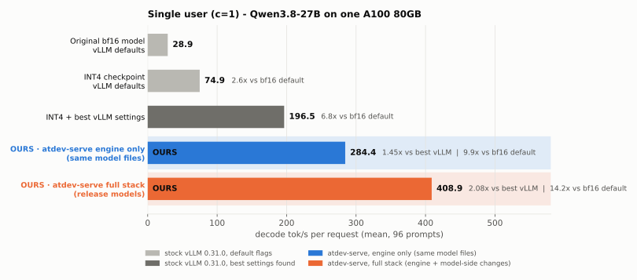
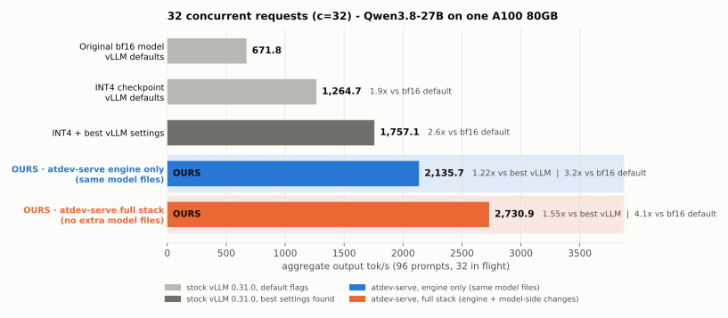
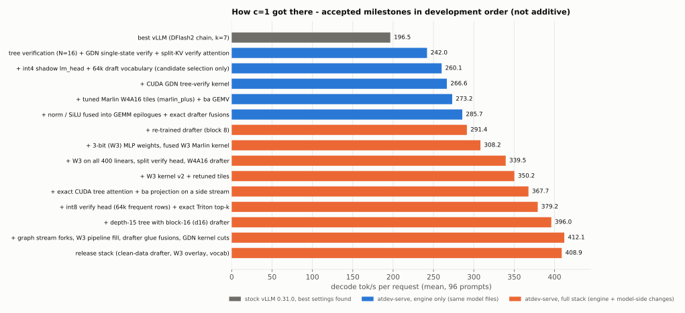
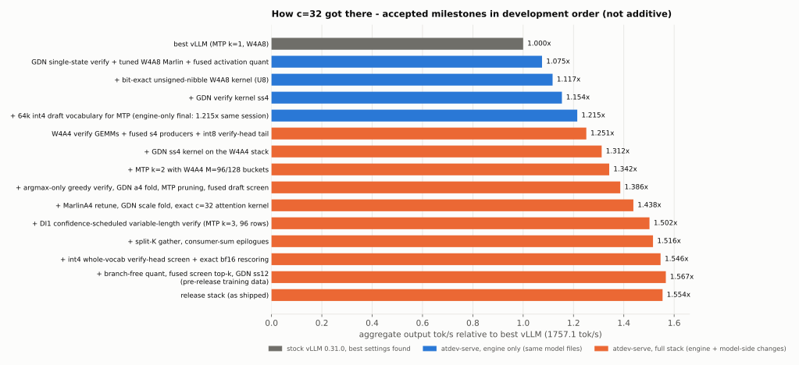

# Benchmarks

All numbers: Qwen3.8-27B, **1x NVIDIA A100 80GB (SXM, sm_80)**, vLLM 0.31.0 (pip wheel, unmodified),
**greedy decoding** (temperature 0).

## Workload and metrics

* **Prompts**: 96 fixed chat prompts (coding, agentic, general, math; 39 in Korean). They are sent
  through the OpenAI-compatible `/v1/chat/completions` endpoint with the model's default chat
  template, `max_tokens=1024`, `temperature=0`, streaming. A warm-up batch runs before every
  measured run.
* **c=1 (1 client)**: a single user, one request at a time. Per-request decode speed =
  (completion tokens - 1) / (time of last token - time of first token). The headline is the **mean
  over the 96 prompts**, averaged over 2 repetitions. The median is reported too.
* **c=32 (32 concurrent clients)**: the same 96 prompts with 32 requests in flight. The headline is **aggregate output
  tok/s** = total completion tokens / wall time.
* The atdev runs and the best-vLLM baselines use the same GPU, vLLM build and client. The
  engine-only c=32 ratio (1.215x) comes from one session with the baseline. The other atdev figures
  were measured in later sessions against the same baselines (196.5 / 1,757.1), which reproduced
  within about 0.5% across sessions. The c=1 headline is the mean of 2 repetitions, and the c=32
  full-stack figure is the mean of 4 alternating rounds.
* Server flags shared by both sides: `--max-model-len 8192 --kv-cache-dtype bfloat16
  --language-model-only --gpu-memory-utilization 0.90 --mamba-ssm-cache-dtype bfloat16`.

## The ladder: from the most basic setup to atdev-serve

### c=1 (1 client, one request at a time): decode tok/s per request (mean of 96 prompts)

| rung | setup | tok/s | vs bf16 default | vs best vLLM |
|---|---|---:|---:|---:|
| 1 | `Qwen/Qwen3.8-27B` (bf16), vLLM defaults, no speculative decoding | 28.9 | 1.0x | 0.15x |
| 2 | `RedHatAI/Qwen3.8-27B-INT4`, vLLM defaults | 74.9 | 2.6x | 0.38x |
| 3 | INT4 + best vLLM settings: DFlash2 drafter k=7, fp8 drafter, bf16 SSM cache | 196.5 | 6.8x | 1.00x |
| 4 | atdev-serve **engine only** (same model files as rung 3) | 284.4 | 9.9x | **1.45x** |
| 5 | atdev-serve **full stack** (`serve_c1.sh`) | **408.9** | **14.2x** | **2.08x** |

Rung 5 median: 388.9 tok/s. Accepted tokens per step (tau): 4.69. The
engine-only figure was 284.4-285.7 across sessions. 284.4 is the re-measurement in the deterministic
kernel-selection mode that ships.

<picture>
  <source media="(prefers-color-scheme: dark)" srcset="img/ladder_c1-dark.svg">
  
</picture>

### c=32 (32 concurrent clients): aggregate output tok/s (96 prompts, 32 in flight)

| rung | setup | tok/s | vs bf16 default | vs best vLLM |
|---|---|---:|---:|---:|
| 1 | `Qwen/Qwen3.8-27B` (bf16), vLLM defaults | 671.8 | 1.0x | 0.38x |
| 2 | `RedHatAI/Qwen3.8-27B-INT4`, vLLM defaults | 1,264.7 | 1.9x | 0.72x |
| 3 | INT4 + best vLLM settings: MTP k=1, W4A8 Marlin, TRITON_ATTN, bf16 SSM cache, no prefix caching | 1,757.1 | 2.6x | 1.00x |
| 4 | atdev-serve **engine only** (same model files as rung 3) | 2,135.7 | 3.2x | **1.22x** |
| 5 | atdev-serve **full stack** (`serve_c32.sh`) | **2,730.9** | **4.1x** | **1.55x** |

<picture>
  <source media="(prefers-color-scheme: dark)" srcset="img/ladder_c32-dark.svg">
  
</picture>

Notes on the ladder:

* Rungs 1-2 run vLLM with **no flags** except the port and the served model name, so they also
  use vLLM's default context length. They were measured
  with the same client and prompts, in a separate session from rungs 3-5. The bf16 model needs about
  73 GB of GPU memory.
* Rung 2 -> 3 is what a careful vLLM user can get from built-in options alone. Rung 3 is the
  denominator for every "x vs best vLLM" ratio.
* Rung 4 adds only atdev engine features. It uses the same RedHatAI INT4 target, the stock z-lab
  DFlash2 drafter (c=1) or the built-in MTP head (c=32), and the same vLLM flags. It includes
  approximations that are used **only to select** speculative candidates (an int4 shadow `lm_head`
  and a frequency-ordered 64k draft vocabulary). The engine builds these at load time and every
  accepted token is verified exactly.
* Rungs 1-3 are plain `vllm serve` commands (see [Baseline launch commands](#baseline-launch-commands))
  and rung 5 is `serve_c1.sh` / `serve_c32.sh`. This release ships no launch script for rung 4
  (engine only).
* Rung 5 also includes model-side changes. c=1: the 3-bit W3 overlay, the re-trained W4A16 block-16
  drafter, and an int8 + int4 split verify head. c=32: W4A4 activations on the large verify GEMMs, an
  int4 MTP head, and an int4 verify-head screen with exact bf16 rescoring.

## Accuracy gates

"c=1" rows use the settings tuned for 1 client, "c=32" rows the settings tuned for 32 concurrent clients.

| configuration | GSM8K (first 300) | GSM8K (all 1319) | long-context (36) |
|---|---:|---:|---:|
| bf16, vLLM defaults | | 0.9469 | 36/36 |
| INT4, vLLM defaults | | 0.9431 | 36/36 |
| best vLLM, c=1 settings | 0.973 | 0.9462 | 36/36 |
| best vLLM, c=32 settings | 0.953 | 0.9439 | 36/36 |
| atdev engine only, c=1 | 0.963 | | 36/36 |
| atdev engine only, c=32 | | 0.9447 | 36/36 |
| atdev full stack, c=1 | 0.967 | 0.9500 | 36/36 |
| atdev full stack, c=32 | | 0.9401 | 36/36 |

* GSM8K: greedy, thinking disabled, answer from `\boxed{}`. GSM8K-300 has a
  resolution of about 1 point at n=300, so GSM8K-1319 is the tie-breaker.
* Long-context: passkey and multi-key retrieval in haystacks of GSM8K questions, 2k-6.5k tokens
* Pass rule used during development: GSM8K within 1 point of the stock reference, long-context 36/36.

## How the baselines were chosen

We swept vLLM 0.31.0's built-in options on the same GPU and kept the best combination for each
concurrency (accuracy-gated where the option changes numerics).

* **c=1 sweep** (1 client; single runs on an earlier 24-prompt set; DFlash2 drafter): k in {5, 6, 7, 8, 10} (k=7 best); `TRITON_ATTN` +4%; bf16 SSM cache
  +9.5%; fp8 drafter quantization +5%; GDN Triton, prefix caching off, local argmax: no gain. MTP k=1..4
  (best 133 tok/s) and the DSpark drafter (161 tok/s) were slower than DFlash2. The best combination
  (DFlash2 k=7 + fp8 drafter + bf16 SSM cache) gives 196.5 mean / 189.3 median on the 96 prompts.
* **c=32 sweep** (32 concurrent clients; 96 prompts): no speculation 1,265; MTP k=1 1,295; + W4A8 (`VLLM_MARLIN_INPUT_DTYPE=int8`) and
  bf16 SSM cache + `TRITON_ATTN` -> 1,757.1. MTP k=2 drops to 1,484.5, and DFlash2 k=3 is not better
  than MTP at c=32. vLLM's adaptive verification is refused for this hybrid (GDN) model in stock vLLM
  0.31.0. `--performance-mode interactivity` and denser CUDA-graph capture sizes were neutral.

## History: how the speedups were built

Each bar is a milestone that passed a same-session A/B against the previous best (paired per-prompt
ratio with a 95% confidence interval at c=1 (1 client), alternating rounds at c=32 (32 concurrent
clients)). The milestones were
measured in different sessions, so read the chart as a history, not as an additive breakdown.
The last development milestones (412.1 tok/s at c=1, 2,753.1 tok/s = 1.567x at c=32) used drafter
and draft-vocabulary data from before the release. The released models were rebuilt from the public
datasets only, which is why the release bars (408.9 and 1.554x) are slightly lower.

<picture>
  <source media="(prefers-color-scheme: dark)" srcset="img/progress_c1-dark.svg">
  
</picture>

<picture>
  <source media="(prefers-color-scheme: dark)" srcset="img/progress_c32-dark.svg">
  
</picture>

The earliest c=32 engine-only ratios were measured against a same-session baseline of 1749-1751
tok/s. The later ratios use 1757.1.

## Baseline launch commands

The best-vLLM baselines (rung 3) are stock vLLM 0.31.0 without the plugin (`ATDEV_OPT` unset):

```bash
# c=1 (1 client)
vllm serve RedHatAI/Qwen3.8-27B-INT4 --port 8100 --served-model-name m \
  --max-model-len 8192 --kv-cache-dtype bfloat16 --language-model-only --gpu-memory-utilization 0.90 \
  --mamba-ssm-cache-dtype bfloat16 \
  --speculative-config '{"method":"dflash","model":"z-lab/Qwen3.8-27B-DFlash2","num_speculative_tokens":7,"quantization":"fp8"}'

# c=32 (32 concurrent clients)
VLLM_MARLIN_INPUT_DTYPE=int8 vllm serve RedHatAI/Qwen3.8-27B-INT4 --port 8100 --served-model-name m \
  --max-model-len 8192 --kv-cache-dtype bfloat16 --language-model-only --gpu-memory-utilization 0.90 \
  --mamba-ssm-cache-dtype bfloat16 --attention-backend TRITON_ATTN --no-enable-prefix-caching \
  --speculative-config '{"method":"mtp","num_speculative_tokens":1}'
```

Rungs 1-2: `vllm serve Qwen/Qwen3.8-27B` (bf16) or `vllm serve RedHatAI/Qwen3.8-27B-INT4` with only
`--port` and `--served-model-name`.

## Measuring on your machine

This repository contains only what is needed to serve the two stacks; the benchmark harness used
for the tables above is not included. To compare on your own hardware, start the baseline and
`serve_c1.sh` / `serve_c32.sh` one after the other on the same idle GPU and send the same prompts
to both with any streaming OpenAI-compatible client, using the metrics defined in
[Workload and metrics](#workload-and-metrics). Discard the first requests after a start (warm-up).

Expect small differences between sessions, typically within about 1%. Other GPUs of the same model
can differ by a few percent (clocks, HBM). Always compare atdev and the baseline in the same session.
