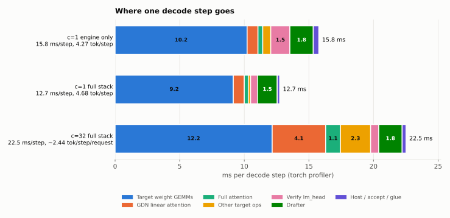
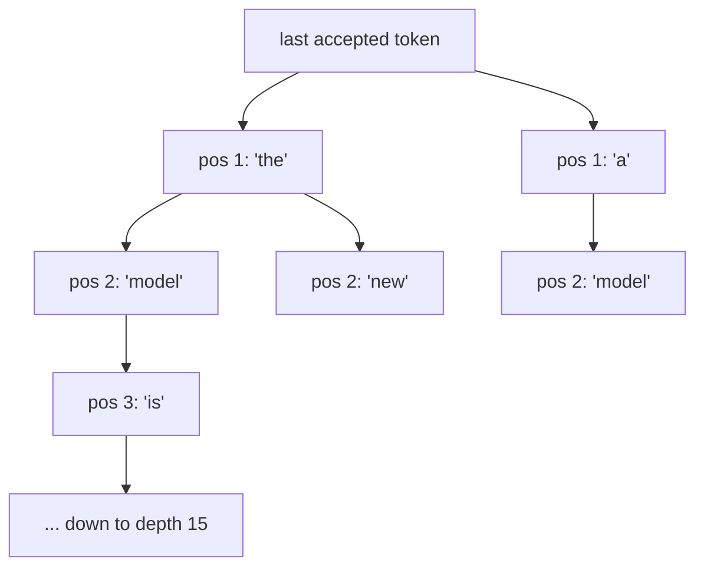
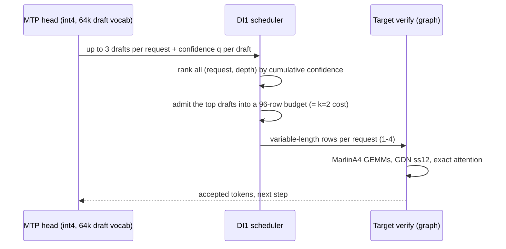

# How atdev-serve works

This page explains what the engine does in each decode step and why it is faster than the best stock
vLLM 0.31.0 configuration. The effects quoted here come from same-session A/B runs during
development (see [BENCHMARKS.md](BENCHMARKS.md) for the method). Throughout, c=N means N concurrent
clients: c=1 is 1 client (a single user, one request at a time), c=32 is 32 concurrent clients (32
requests in flight).

## Background: where the time goes

Qwen3.8-27B has 64 decoder layers: **48 Gated DeltaNet (GDN) linear-attention layers** and **16
full-attention layers**. When decoding a few tokens at a time on an A100, a step is dominated by
reading the weights (about 12 GB of INT4 linear weights plus a 2.5 GB bf16 `lm_head` per pass). Speculative decoding spreads that weight
read over several tokens: a small drafter proposes tokens, the target verifies them in one pass, and
the engine keeps the longest correct prefix. Two things then decide the speed:

* **tau**, the tokens accepted per step (drafter quality and how many candidates are verified)
* **step time**, the cost of one draft + verify round (kernels)

The step time measured with the torch profiler:

<picture>
  <source media="(prefers-color-scheme: dark)" srcset="img/step_breakdown-dark.svg">
  
</picture>

* At c=1 (1 client) the target weight GEMMs take about 72% of the step. Their size cannot shrink without
  changing the weights, which is why the full stack adds 3-bit weights. Everything else (GDN,
  attention, heads, drafter) was cut kernel by kernel.
* At c=32 (32 concurrent clients) the step verifies about 96 rows, so the GEMMs become compute-heavy. W4A4 (4-bit
  activations on tensor cores) is the biggest lever there, followed by the GDN kernels.

## The c=1 stack (`serve_c1.sh`, tuned for 1 client)

### Tree verification with a block-16 drafter

DFlash2 is a block-diffusion drafter: in one pass it predicts a whole block of future positions, with
a score for each candidate token at each position. Stock vLLM verifies only the top-1 chain (k=7 was
the best setting). atdev-serve builds a **token tree** instead:

* The tree has **16 nodes** and a depth of up to **15**. It is built best-first from the drafter's
  candidate scores (`dflash_tree`, Triton/CUDA tree builder).
* The target verifies all 16 nodes in **one forward pass**. Full attention uses an ancestor mask
  (`tree_attn`, a CUDA kernel that reproduces vLLM's Triton attention bit for bit, with the gate and
  KV write fused). The GDN layers run a **tree recurrence**: each node's state is its parent's state
  plus one delta-rule update (`gdn_tree_cuda`, one fused kernel for conv, gating, recurrence and norm).
* **Exact greedy acceptance**: a node is accepted only if it equals the target's argmax at its parent,
  so the output is the target's own greedy output.
* The drafter shipped with the release is DFlash2 **re-trained by self-distillation** (target-generated
  responses, prompts from ultrachat_200k and GSM8K train only) for block 16 and quantized to W4A16.
  Going from block 8 to block 16 raised the served tau from 4.52 to 4.68 (+3.8% tok/s).

Why not a wider tree? A 32-node tree would accept about 7.5% more tokens, but a 32-row GEMM costs
about 20% more than a 16-row GEMM on the A100 (tile size). The measured net effect was 0.90x, so 16
nodes stays.

### Keeping the GDN state cheap

Stock speculative decoding stores one GDN state per draft position. atdev-serve
(`gdn_single_state`) writes **one** state per step plus a small log of the per-token updates, then
replays only the accepted tokens. The GDN metadata for all layer groups is built in one launch
(`gdn_meta_fast`).

### Candidate selection on a small vocabulary

The drafter's output head is the biggest part of drafting. `draft_vocab` restricts candidate scoring
to the **64k most frequent tokens** (`data/token_order.npy`), using an int4 copy of those `lm_head`
rows (`shadow_head`). This only decides *which* tokens enter the tree, and the target still verifies
every one exactly. That is why it counts as an engine feature: the model files are unchanged and the
outputs come from the exact path. (+7.5%)

### Kernels and fusions

* `marlin_plus`: Marlin W4A16 with per-shape launch configurations for the M=16 verify GEMMs (+2.4%)
* `c1_fuse`: RMSNorm, the residual add and SiLU-mul folded into the Marlin epilogues of the
  neighbouring GEMMs (+3.5%)
* `ba_gemv`: a small GEMV for GDN's `in_proj_ba`, run on a side stream inside the CUDA graph
* `attn_split_verify`: split-KV attention for verify queries
* `ll1_fuse`, `ll5_fuse`, `drafter_ctxfold`: drafter and accept-path glue fused or overlapped. All are
  bit-identical, and together they give a gain of about 1-2%.

### Model-side parts of the c=1 full stack

| part | what changes | measured effect |
|---|---|---|
| W3 overlay (`w3_mixed`) | 400 linear layers in 3-bit GPTQ (act-order, damp 0.3, g128), served by fused W3 Marlin kernels (`marlin_c1_w3_build`) | MLP layers: +6.5%; the remaining layers: +4.3%; W3 kernel v2 + tuning: +3.4% |
| d16 drafter (`drafter_w4`) | re-trained DFlash2, block 16, W4A16 (fc in int8) | int4 drafter: +3.3%; block 16: +3.8% |
| split verify head (`verify_split_head`) | verify `lm_head` = int8 rows for the 64k frequent tokens + int4 rows for the rest | +4.4%, then +3.5% (int8 rows) |

The W3 overlay and the drafter are published in one Hugging Face repo,
[`atdev-company/Qwen3.8-27B-atdev-c1`](https://huggingface.co/atdev-company/Qwen3.8-27B-atdev-c1)
(subfolders `w3/` and `drafter/`); the split verify head is built from the target at load time.
Because these change numerics, outputs are not token-identical to stock vLLM. The accuracy gates
(GSM8K-300 / 1319, long-context 36/36) are the acceptance criterion.

## The c=32 stack (`serve_c32.sh`, tuned for 32 concurrent clients)

With 32 requests in flight a step already has plenty of rows. The goal changes: verify only the
drafts that are likely to be accepted, and make the large GEMMs cheaper.

### DI1: confidence-scheduled variable-length verification

* MTP drafts up to k=3 tokens per request, but the verify batch keeps the row count of k=2 (96 rows
  at 32 requests). Confident requests get 3 drafts verified and uncertain ones get fewer. When fewer
  requests remain (the tail of a batch), every draft fits.
* This uses vLLM 0.31's own adaptive-verification machinery (device-side draft re-allocation,
  variable-length CUDA graphs), which stock vLLM does not enable for GDN models. `di1_varlen` enables
  it, declares the GDN kernels variable-length safe, and fixes two capture bugs.
* Tokens per step went from 2.24-2.31 to 2.41-2.47, for +2.1% to +2.9% throughput.

### W4A4 verify GEMMs (MarlinA4)

* The large verify GEMMs (GDN qkvz / gate-up / down / out, attention qkv / o) run with 4-bit weights
  **and** 4-bit activations on int4 tensor cores (`marlin_plus` A4 configs).
* The activation quantizers are fused into the producers: the RMSNorm, SiLU-mul and gate kernels
  write the 4-bit activations and their scales directly (`fused_quant`, `gdn_a4_fold`, `c32c_csum`).
* Split-K with a parallel reduction, and a branch-free correctly rounded quotient in the quantizers
  (`ATDEV_C32_MK`). `c32k_fuse` fuses the screen's top-k glue.
* MarlinA4 is still about 54% of the c=32 step.

### GDN, attention and heads

* `gdn_ss12`: the GDN verify kernel for variable-length requests. It keeps one state per request and
  uses longest-processing-time CTA ordering (first version +5.75%, later versions small bit-identical
  gains).
* `c32_attn`: CUDA verify attention, bit-identical to the stock path (+1.7%).
* `vsplit_a4scr`: the greedy verify head. A W4A4 int4 screen over all 248k `lm_head` rows picks the
  top 16 candidates per row, and those candidates are rescored with an fp32 dot product against the
  **original bf16 rows**. The approximate logits only choose candidates. Head time at M=96 went from
  1.34 to 0.63 ms, and the result is closer to exact bf16 than the previous split head (argmax
  agreement on a microbenchmark: 750/768 vs 618/768). (+2.2%)
* `mtp_w4`, `mtp_prune`, `vsplit_mtp`: int4 MTP head, the MTP pass 1 runs only the rows that are
  needed, and an argmax-only greedy verify path (+1.8%).
* `draft_vocab`: 64k int4 draft vocabulary for the MTP drafts (+3%).

## Feature flags

Each launch script lists every setting. Features are switched on with `ATDEV_OPT`:

| stack | `ATDEV_OPT` |
|---|---|
| c=1 | `gdn_single_state, dflash_tree, attn_split_verify, gdn_meta_fast, shadow_head, draft_vocab, marlin_plus, ba_gemv, c1_fuse, drafter_ctxfold, w3_mixed, verify_split_head, drafter_w4, tree_attn, ll1_fuse, ll5_fuse` |
| c=32 | `draft_vocab, gdn_single_state, verify_split_head, mtp_w4, marlin_plus, fused_quant, vsplit_mtp, gdn_a4_fold, mtp_prune, c32_attn, di1_varlen, c32_conv, c32k_fuse` |

On start-up the server log prints `atdev-serve: enabled optimizations: [...]`. An unknown name
stops the server with an error, so a typo cannot silently fall back to stock vLLM. Every feature is a runtime patch, so the vLLM files on disk are never changed.

## What did not work

These ideas were tried and measured, and none of them shipped:

* Wider trees (24 / 32 / 48 nodes) at c=1: a 0.73-0.90x net effect, because the larger verify GEMM
  costs more than the extra accepted tokens gain.
* W4A4 at c=1 (M=16): neutral speed with a lower accuracy margin.
* Overlap tricks at c=1 (PDL emulation, L2 prefetch, two-stream GEMMs): one M=16 GEMM already uses
  all SMs, so there was at most about 2 us of overlap per GEMM boundary.
* A custom M<=16 W4A16 GEMM written from scratch: capped at Marlin's ~1.4 TB/s by the tile layout.
* Fixed MTP k=3 at c=32 (every draft verified): +15.9% tokens per step for +20% step time. DI1
  keeps the k=2 row budget instead.
* FlashInfer tree attention at c=1: faster kernels, but the planning cost is paid on the host every
  step.
